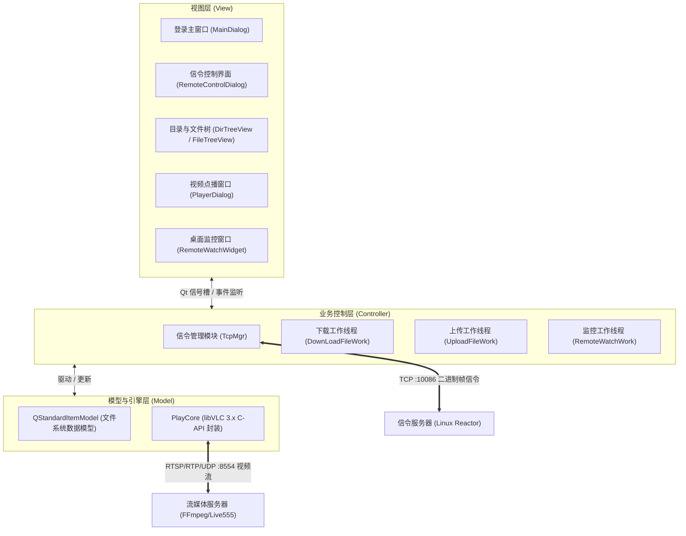

# NoDeskServerKit 客户端 (RemoteControlClient)

> **面向无桌面（Headless）Linux 服务器的高效流媒体点播与远程文件管控系统**  
> 基于 **Qt 6 (C++17) + libVLC 3.x** 构建，支持远程登录鉴权、目录树浏览、大文件 512KB 分块断点式上下传、RTSP/RTP 低延迟视频秒开点播，以及低延迟桌面监控（方案 B）与键鼠反向控制。

---

## 1. 项目背景与解决的痛点

在基于深度学习（如 YOLOv8 目标检测、视频实例分割）的模型研发与科研训练中，GPU 训练服务器通常为无桌面环境（Ubuntu Server 等 Headless 系统）。开发者面临以下痛点：
1. **多工具链路割裂**：依赖 SSH/VSCode/SFTP 多端频繁切换上传数据集、下载推理视频、再打开本地播放器核对标注效果，流程繁琐。
2. **大文件往返下载开销大**：模型调优验证涉及频繁的视频结果核验，动辄几百兆至数吉字节的视频全量下载严重拉低科研迭代效率。

**NoDeskServerKit** 通过“**信令管控 + 局域网流媒体点播**”一体化方案，让开发者无需下载视频即可在本地秒开预览远程服务器推理成果，并一站式管控远程文件。

---

## 2. 核心功能特性

- **🔐 远程安全登录**：最先显示登录主窗口，输入服务器 IP、信令端口、RTSP 端口与 Linux 系统账密，服务端进行系统鉴权后方可进入控制台。
- **📁 目录与文件管理**：
  - 登录成功自动加载家目录（`/home/<user>`）与分区树；
  - 动态按需展开子目录，实时显示文件大小、权限、最后修改时间等元数据；
  - 支持远程文件**下载**（512KB 分块、写就绪驱动、进度条实时反馈与取消）。
  - 支持远程文件**上传**（512KB 异步切块、5ms 节流流控、同名覆盖、取消上传并通知服务端丢弃清理）。
  - 支持远程文件**执行**（脚本/程序）与**删除**（联动 UI 节点自动移除）。
- **🎬 RTSP 低延迟流媒体点播**：
  - 文件列表中右键音视频文件（支持 `.mp4`、`.mkv`、`.avi`、`.flv`、`.mov` 等）直接拉流播放；
  - 基于 **libVLC 3.x** 播放引擎，绑定原生窗口句柄（HWND）硬件加速直出渲染；
  - 悬浮半透明毛玻璃控制条（3 秒静止平滑淡出），支持精准毫秒级 Seek、播放/暂停、音量调节与静音。
- **🖥️ 方案 B 远程桌面监控与控制**：
  - **无桌面智能自适应**：服务端探测无 X11/Wayland 桌面（Headless）时友好拦截提示，不弹空白窗；
  - **低延迟硬件推流**：服务端有桌面时通过 H.264 编码以 `rtsp://ip:8554/desktop` 独立推流，延迟仅 30~60ms，避免与信令文件传输竞争带宽；
  - **反向键鼠控制**：在监控窗口中拦截鼠标（按键/移动/双击/滚轮）与键盘（键值/修饰键掩码，过滤 auto-repeat），经信令通道实时注入服务端。
- **🎨 现代深色科技风 UI**：Fluent / Slate 极简深色主题（`style.qss`），高质感居中登录卡片、精致树状表头、极细滚动条。

---

## 3. 架构设计与技术选型

### 3.1 总体架构 (MVC)



### 3.2 为什么选用 libVLC？

| 方案 | 延迟 / 鲁棒性 | 开发与维护成本 | 特性匹配度 |
| :--- | :--- | :--- | :--- |
| **libVLC（本项目选定）** | **工业级 RTSP 容错，秒开与 Seek 极佳** | **低（封装面向对象接口）** | **最佳方案，稳定可靠** |
| 自研 FFmpeg + SDL | 取决于手写状态机质量，音画同步容易漂移 | 极高（需自研 A/V Sync 与解码线程） | 适合像素级图像处理 |
| QtMultimedia | 早期版本 Windows RTSP 支持差，定制参数弱 | 极低 | 协议鲁棒性不足 |

---

## 4. 通信协议规范概览

信令服务器运行于 TCP 端口 `10086`，采用二进制帧封装 + JSON 载荷通信：

```
+-------------+----------------+----------------+-------------------+----------------+
| Start Flag  | Data Length    | Message ID     | Message Body      | Checksum       |
| 2 bytes     | 4 bytes        | 2 bytes        | N bytes           | 2 bytes        |
| 0xFE 0xFF   | Big-Endian     | Big-Endian     | UTF-8 JSON        | Big-Endian     |
+-------------+----------------+----------------+-------------------+----------------+
```

### 消息指令表

| ID | 指令宏 | 方向 | 功能描述 |
| :--- | :--- | :--- | :--- |
| `1000` | `LOGIN_USER` | C ⇄ S | 账密登录鉴权（0:成功 / 1:用户不存在 / 2:密码错 / 3:系统错） |
| `1001` | `GET_DRIVERINFO` | C ⇄ S | 获取磁盘分区与家目录根路径 |
| `1002` | `GET_DIRINFO` | C ⇄ S | 逐项推送目录与文件列表，`next:false` 标识结束 |
| `1003` | `DOWNLOAD_FILE` | C ⇄ S | 文件头元数据 + 512KB 分块切片下载（Base64 编码） |
| `1004` | `EXECUTE_FILE` | C ⇄ S | 远程执行指定文件 |
| `1005` | `DELETE_FILE` | C ⇄ S | 远程删除指定文件 |
| `1006` | `JOIN_TCP_REMOTEWATCH` | C ⇄ S | 请求加入桌面监控（0:开启RTSP / 1:无桌面 / 2:编码错） |
| `1008` | `EXIT_TCP_REMOTEWATCH` | C ⇄ S | 退出桌面监控并释放资源 |
| `1009` | `MOUSE_REMOTE_CONTROL` | C → S | 鼠标事件（归一化坐标、键位、双击、滚轮） |
| `1010` | `LOCK_REMOTE_CONTROL` | C → S | 远程锁定主机屏幕 |
| `1011` | `UNLOCK_REMOTE_CONTROL`| C → S | 远程解锁主机屏幕 |
| `1012` | `UPLOAD_FILE` | C ⇄ S | 客户端 512KB 异步切片上传，服务端校验落盘并回响应 |
| `1013` | `CANCEL_UPLOAD_FILE` | C → S | 取消正在进行的文件上传 |
| `1015` | `KEYBOARD_REMOTE_CONTROL` | C → S | 键盘事件（Qt 键码、修饰键掩码、字符、按压/释放） |

> 完整 JSON 字段结构与 RTSP 封包规范请参阅：[`文档/NoDeskServerKit_服务端实现规范.md`](文档/NoDeskServerKit_服务端实现规范.md)。

---

## 5. 项目工程结构

```
RemoteControlClient/
├── RemoteControlClient.pro    # qmake 工程文件（自动探测并配置 64位 libVLC）
├── README.md                  # 本文档
├── main.cpp                   # 应用程序入口，加载 QSS 样式表与单例主窗体
├── global.h                   # 全局宏定义、消息 ID 枚举、数据包结构体
├── style.qss                  # 全局现代深色科技风样式表
├── resources.qrc              # Qt 资源文件，打包 style.qss
│
├── TcpPacket.h / .cpp         # 二进制帧序列化、反序列化、16位累加和校验算法
├── tcpmgr.h / .cpp            # TCP 长连接管理单例、网络子线程、消息分发与回调
│
├── mainwindow.h / .cpp / .ui  # 顶层窗口容器，负责登录页与主控页的平滑切换
├── maindialog.h / .cpp / .ui  # 居中拟态登录主窗口，处理 IP/端口/账密输入与连接鉴权
├── remotecontroldialog.h/.cpp/.ui # 信令控制主界面，集成目录树、文件表、远程工具栏
│
├── dirtreeview.h / .cpp       # 目录树控件（继承 QTreeView），支持层级展开加载
├── filetreeview.h / .cpp      # 文件列表控件，实现右键菜单、下载/上传/删除/执行/点播入口
├── downloadfilework.h / .cpp  # 异步文件下载任务对象（运行在专属子线程）
├── uploadfilework.h / .cpp    # 异步文件上传任务对象（512KB 分块 + 节流流控）
│
├── playcore.h / .cpp          # 播放引擎（基于 libVLC C-API，支持降级 NO_VLC 空实现）
├── playerdialog.h / .cpp / .ui# 独立视频点播窗口，HWND 原生渲染 + 悬浮控制条
│
├── remotewatchwidget.h / .cpp / .ui # 方案 B 桌面监控窗口，集成 PlayCore 拉流与键鼠捕获
├── remotewatchwork.h / .cpp   # 监控信令交互与工作状态管理对象
│
├── vlc_sdk/                   # 本地 64位 libVLC SDK 目录
│   ├── plugins/               # VLC 音视频解码插件目录
│   └── sdk/
│       ├── include/vlc/       # libVLC 3.x 标准 C 头文件
│       └── lib/               # 64位 MinGW 导入库 (libvlc.dll.a / libvlccore.dll.a)
│
└── 文档/
    ├── NoDeskServerKit客户端设计文档.md   # 客户端详细设计与时序图
    └── NoDeskServerKit_服务端实现规范.md   # 服务端信令与流媒体协议实现规范
```

---

## 6. 环境依赖与构建指南

### 6.1 开发环境推荐
- **操作系统**：Windows 10 / 11 (64-bit)
- **编译工具**：MinGW 64-bit（GCC 11.2+ 或 13.1+）
- **Qt 版本**：Qt 6.7.0 (MinGW 64-bit) 或更高版本的 Qt 6
- **第三方库**：libVLC 64-bit（工程已内嵌 64位 `vlc_sdk`）

### 6.2 编译步骤

#### 方式 A：Qt Creator（推荐）
1. 使用 Qt Creator 打开 `RemoteControlClient.pro`；
2. 构建套件（Kit）选择 **`Desktop Qt 6.7.0 MinGW 64-bit`**；
3. 点击 **构建**（`Ctrl+B`）或 **运行**（`Ctrl+R`）。
   - 工程配置包含 `QMAKE_POST_LINK`，会自动将 64位 `libvlc.dll` 和 `libvlccore.dll` 拷贝至目标构建目录。

#### 方式 B：命令行构建 (PowerShell)
```powershell
# 1. 进入工程目录
cd D:\path\to\RemoteControlClient

# 2. 生成 Makefile
qmake RemoteControlClient.pro -o build/Makefile

# 3. 执行编译 (使用 MinGW 64-bit)
mingw32-make -C build -f Makefile.Debug -j4
```
编译成功后，可执行文件输出至 `build/Desktop_Qt_6_7_0_MinGW_64_bit-Debug/debug/RemoteControlClient.exe` 或 `build/debug/RemoteControlClient.exe`。

---

## 7. 运行与操作指南

1. **启动程序**：运行 `RemoteControlClient.exe`，展现居中深色登录界面；
2. **连接登录**：
   - 输入目标 Linux 服务器 IP 地址（如 `192.168.1.100`）；
   - 输入信令端口（默认 `10086`）与流媒体端口（默认 `8554`）；
   - 输入服务器 Linux 用户名与密码，点击“**连接并登录**”；
3. **文件管理**：
   - 登录成功后自动拉取家目录树，点击目录节点按需加载子文件；
   - 右键任意文件：
     - **下载文件**：选择本地保存路径，进度条实时更新；
     - **上传文件**：选择本地文件，异步分块上传至该目录（支持取消）；
     - **流媒体播放**：针对视频文件唤起独立点播窗口，秒开预览；
     - **运行文件 / 删除文件**：远程触发脚本执行或文件清除；
4. **远程监控**：
   - 点击顶部工具栏“**远程监控**”；
   - 若服务器为无桌面环境，将弹出保护提示；若有桌面，将打开监控窗口低延迟显示桌面，并可在窗口内直接通过键盘鼠标操作远端系统；
5. **返回 / 退出**：
   - 点击“返回登录”可断开当前长连接并安全返回登录窗口。

---

## 8. 开源许可与致谢

- 遵循 **MIT License** 开源协议。
- 视频解码与流媒体播放基于 [VideoLAN libVLC](https://www.videolan.org/vlc/libvlc.html) 项目，遵循 LGPL 许可。
