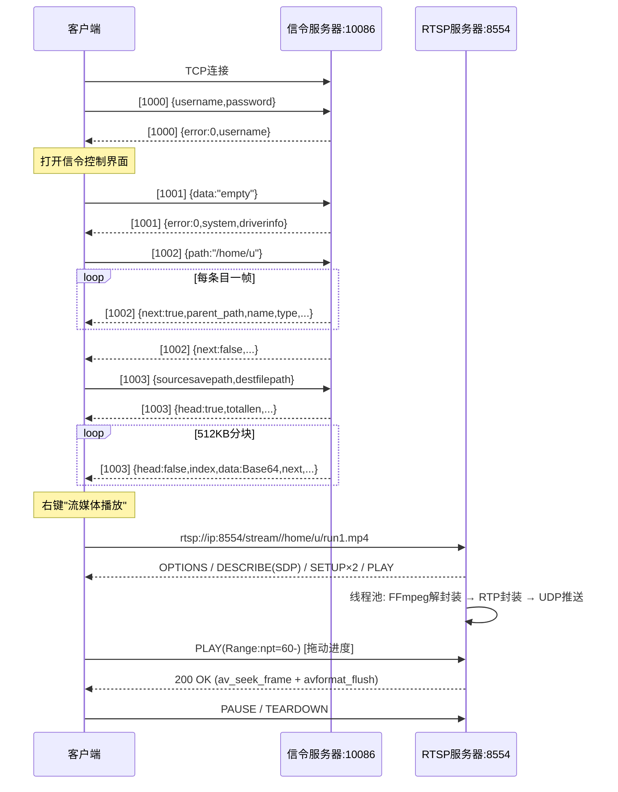

# NoDeskServerKit 服务端实现规范文档（信令服务器 + RTSP 流媒体服务器）

> 本文档基于客户端源码 `RemoteControlClient` **反向提炼**，作为服务端（Linux）实现的唯一协议依据。
> 涉及源码文件：`global.h`、`TcpPacket.h/.cpp`、`tcpmgr.h/.cpp`、`maindialog.cpp`、`dirtreeview.cpp`、`filetreeview.cpp`、`remotecontroldialog.cpp`、`remotewatchwidget.cpp`、`playcore.cpp`。

---

## 1. 总体架构与部署要求

| 服务 | 协议 | 默认端口 | 职责 |
| :--- | :--- | :--- | :--- |
| **信令服务器** | 自定义 TCP（二进制帧 + JSON 载荷） | `10086` | 登录鉴权、目录/文件管理、上传下载、远程监控与锁机指令 |
| **RTSP 流媒体服务器** | RTSP / RTP / RTCP | `8554` | 视频点播（OPTIONS/DESCRIBE/SETUP/PLAY/PAUSE/TEARDOWN），RTP 推送 H.264 + AAC |

- 两个服务可合进程也可分进程部署；**RTSP 端口由客户端登录界面输入并上报**，信令端口由客户端输入。
- 信令服务器需运行在具备目标用户账号的 Linux 主机上（登录鉴权走系统账号校验）。
- 推荐实现模型：**主从 Reactor（epoll）+ 线程池**，大文件传输避免阻塞事件循环。

### 1.1 关键约束
1. 信令通道为**单 TCP 长连接**，所有消息复用同一条连接，服务端需自行做**粘包/半包处理**。
2. 所有多字节整数均使用**网络字节序（Big-Endian）**。
3. 消息载荷统一为 **UTF-8 编码的 JSON 对象**（`QJsonDocument::toJson()` 默认为紧凑格式，服务端用标准 JSON 解析器即可）。
4. 文件块、截图等**二进制数据必须 Base64 编码**后放入 JSON 字符串字段。

---

## 2. 信令服务器 —— 二进制帧协议

### 2.1 帧结构（发送与接收完全一致）

```
+-------------+----------------+----------------+-------------------+----------------+
| Start Flag  | Data Length    | Message ID     | Message Body      | Checksum       |
| 2 bytes     | 4 bytes        | 2 bytes        | N bytes           | 2 bytes        |
| 0xFE 0xFF   | (BE)           | (BE)           | (JSON, UTF-8)     | (BE)           |
+-------------+----------------+----------------+-------------------+----------------+
```

| 字段 | 长度 | 字节序 | 说明 |
| :--- | :--- | :--- | :--- |
| **Start Flag** | 2 | — | 固定 `0xFE 0xFF`。接收方需扫描到该标记后开始解析，标记前的垃圾字节全部丢弃 |
| **Data Length** | 4 | Big-Endian | 后续三段的总长度 = `Message ID(2) + Message Body(N) + Checksum(2)`，**不含** Start Flag 与自身 |
| **Message ID** | 2 | Big-Endian | 见 2.2 节枚举 |
| **Message Body** | N | — | UTF-8 JSON 文本（可为空对象 `{}`） |
| **Checksum** | 2 | Big-Endian | **16 位无符号按字节累加和**，算法见 2.3 |

> 单帧最小长度（Body 为空时）：`2 + 4 + 2 + 0 + 2 = 10` 字节。

### 2.2 消息 ID（DataId 枚举，与 `global.h` 完全一致）

| ID | 名称 | 方向 | 用途 |
| :--- | :--- | :--- | :--- |
| `1000` | `LOGIN_USER` | C→S / S→C | 远程登录 |
| `1001` | `GET_DRIVERINFO` | C→S / S→C | 获取磁盘分区/根目录信息 |
| `1002` | `GET_DIRINFO` | C→S / S→C | 获取指定目录下的目录与文件列表（逐条推送） |
| `1003` | `DOWNLOAD_FILE` | C→S / S→C | 文件下载（文件头 + 分块数据） |
| `1004` | `EXECUTE_FILE` | C→S / S→C | 远程执行文件 |
| `1005` | `DELETE_FILE` | C→S / S→C | 远程删除文件 |
| `1006` | `JOIN_TCP_REMOTEWATCH` | C→S / S→C | 加入远程监控推送组 |
| `1007` | `GET_REMOTEWATCH_SCREEN` | S→C | 推送远程监控屏幕截图 |
| `1008` | `EXIT_TCP_REMOTEWATCH` | C→S / S→C | 退出远程监控推送组 |
| `1009` | `MOUSE_REMOTE_CONTROL` | C→S | 远程鼠标事件注入 |
| `1010` | `LOCK_REMOTE_CONTROL` | C→S | 远程锁屏 |
| `1011` | `UNLOCK_REMOTE_CONTROL` | C→S | 远程解锁 |
| `1012` | `UPLOAD_FILE` | C→S / S→C | 文件上传（客户端分块发送，服务端组包并回响应） |
| `1013` | `CANCEL_UPLOAD_FILE` | C→S | 取消上传（服务端丢弃后续该文件块并清理） |
| `1015` | `KEYBOARD_REMOTE_CONTROL` | C→S | 远程键盘事件注入（按下/释放） |
| `1100` | `SEND_MSG` | S→C | （预留）聊天消息 |
| `1101` | `SEND_FILE` | S→C | （预留）聊天文件 |

> **上传文件功能（已实现）**：客户端已定义 `UPLOAD_FILE=1012` 与 `CANCEL_UPLOAD_FILE=1013`，协议详见 3.4A / 3.4B 节；服务端按 `offset` 组包落盘并逐块回响应。

### 2.3 校验和算法（务必精确实现）

**发送方（服务端构建帧时）**：
```
sum = 0
sum += 0xFE + 0xFF
sum += b(DataLen[0]) + b(DataLen[1]) + b(DataLen[2]) + b(DataLen[3])   // DataLen 的 4 个原始字节（已按 BE 存放）
sum += MessageID[0] + MessageID[1]                                      // 2 个原始字节
sum += 逐字节累加 MessageBody                                            // N 个原始字节
checksum = sum & 0xFFFF                                                  // 截断为 16 位
写入帧尾（Big-Endian）
```

**接收方（校验时）**：对 `DataLen + MessageID + MessageBody` 的原始字节累加，加上 `0xFE + 0xFF`，与帧尾的校验和（先转主机序）比对；不匹配则丢弃该帧。

> ⚠️ 注意：`0xFE + 0xFF = 511`，且 **Checksum 自身不参与累加**。累加和可能超过 255，务必使用 `uint16_t` 溢出回绕语义（等价于取低 16 位）。

### 2.4 接收状态机（服务端解析流程）

```
1. 缓冲区追加新到字节。
2. 若未找到起始标记：扫描 0xFE 0xFF，命中前全部丢弃；若缓冲区末尾恰好是 0xFE，保留 1 字节等待。
3. 已找到标记但不足 4 字节 DataLen：等待。
4. 读取 DataLen（BE 转主机序），记为 L。
5. 若缓冲区剩余 < L：等待更多数据。
6. 截取 L 字节作为 [MessageID(2) | Body(L-4) | Checksum(2)]，校验 checksum。
7. 校验通过 → 按 MessageID 分发处理；否则丢弃。
8. 重复 2 处理下一帧（单次读取可能包含多帧）。
```

---

## 3. 信令服务器 —— 各消息 JSON 协议

> 所有请求/响应 Body 均为 JSON 对象。**服务端回复时复用相同 Message ID**。

### 3.1 `1000` LOGIN_USER —— 登录

**客户端 → 服务端**：
```json
{ "username": "zhangsan", "password": "xxx" }
```

**服务端 → 客户端**（客户端校验字段：`error`、`username` 均必须存在）：
```json
{ "error": 0, "username": "zhangsan" }
```

| error 值 | LoginStatus 枚举 | 客户端行为 |
| :--- | :--- | :--- |
| `0` | `LOGIN_SUCCESS` | 弹窗"登录成功"，打开信令控制界面 |
| `1` | `LOGIN_USERNAME_ERROR` | 提示"用户不存在"，**断开 TCP** |
| `2` | `LOGIN_PASSWORD_ERROR` | 提示"密码错误"，**断开 TCP** |
| `3` | `LOGIN_SYSTEM_ERROR` | 提示"服务器内部错误"，**断开 TCP** |

**鉴权实现要求**：服务端校验 Linux 系统账号（如 PAM / `getspnam()` + `crypt()`），成功后**保存该用户名与会话绑定**，后续 `GET_DIRINFO` 返回其家目录 `/home/<username>`。鉴权失败需立即断开连接（客户端也会断开）。

---

### 3.2 `1001` GET_DRIVERINFO —— 获取磁盘分区/根目录

**客户端 → 服务端**：
```json
{ "data": "empty" }
```

**服务端 → 客户端**（必需字段：`error`、`system`、`driverinfo`）：
```json
{ "error": 0, "system": "Linux", "driverinfo": "/home/zhangsan" }
```

| 字段 | 类型 | 说明 |
| :--- | :--- | :--- |
| `error` | int | `0` 成功；非 0 时客户端丢弃 |
| `system` | string | 系统标识（仅打印日志），如 `"Linux"` |
| `driverinfo` | string | **根路径列表，逗号分隔**。Linux 单分区时即 `"/home/zhangsan"`（客户端 split(",") 后逐项插入目录树根） |

> 客户端收到后会清空并重建 `DirTreeView` 顶级节点。

---

### 3.3 `1002` GET_DIRINFO —— 获取目录内容（逐条推送）

**客户端 → 服务端**：
```json
{ "path": "/home/zhangsan/dataset" }
```

**服务端 → 客户端**：对该目录下**每一个条目发送一帧**（每帧 1 条记录），字段必需包含 `error`、`parent_path`、`next`：

```json
{
  "error": 0,
  "next": true,
  "parent_path": "/home/zhangsan/dataset",
  "name": "run1.mp4",
  "type": "file",
  "size": 104857600,
  "permissions": "-rw-r--r--",
  "access_time": "2026-10-11 21:30:00",
  "symlink_target": ""
}
```

| 字段 | 类型 | 说明 |
| :--- | :--- | :--- |
| `error` | int | `0` 正常条目 |
| `next` | bool | **`true` = 还有后续条目/本条为有效数据；`false` = 传输结束标记帧**（客户端收到 `next:false` 打印"目录数据完毕"） |
| `parent_path` | string | 该条目**父目录绝对路径**（客户端据此定位插入的父节点） |
| `name` | string | 目录/文件名（不含路径） |
| `type` | string | `"directory"` → 插入目录树；`"file"` / `"other"` → 插入文件列表 |
| `size` | int64 | 大小（目录可填子项数量或 0） |
| `permissions` | string | 权限字符串，如 `drwxr-xr-x` |
| `access_time` | string | 最后访问/修改时间 |
| `symlink_target` | string | 软链接目标；非软链填 `""` |

**推送顺序建议**：先发完所有目录条目，再发所有文件条目，最后发一帧 `{"error":0,"next":false,"parent_path":"..."}` 结束帧。
**边界情况**：空目录至少发送 1 帧 `next:false` 结束帧，否则客户端会一直等待。

---

### 3.4 `1003` DOWNLOAD_FILE —— 文件下载（头 + 512KB 分块）

**客户端 → 服务端（请求）**：
```json
{ "sourcesavepath": "D:/Videos/save", "destfilepath": "/home/zhangsan/run1.mp4" }
```
| 字段 | 说明 |
| :--- | :--- |
| `sourcesavepath` | 客户端本地保存目录（服务端原样回传，供客户端匹配下载任务） |
| `destfilepath` | 服务端被下载文件的绝对路径 |

**服务端 → 客户端（第一步：文件头）**：
```json
{
  "error": 0,
  "head": true,
  "sourcesavepath": "D:/Videos/save",
  "destfilepath": "/home/zhangsan/run1.mp4",
  "length": 0,
  "totallen": 104857600,
  "next": true,
  "index": 0
}
```
- 文件不存在/无权限：`"error": 1, "head": true, ...` → 客户端提示"文件不存在或没有权限"。
- `totallen` 为文件总字节数。
- **关键流控**：客户端收到 `head:true, error:0` 后会**阻塞等待 UI 创建进度条**，随后才通过 `tcp_signal()` 唤醒。服务端**必须在发出文件头后暂停发送数据块**，建议延迟 100~300ms 或等待客户端首个块交互后再连续推送（客户端协议本身无 ACK，稳妥做法是低速起步 + 按 TCP 拥塞自然窗口推进）。

**服务端 → 客户端（第二步：分块，每帧一块）**：
```json
{
  "error": 0,
  "head": false,
  "sourcesavepath": "D:/Videos/save",
  "destfilepath": "/home/zhangsan/run1.mp4",
  "length": 524288,
  "totallen": 104857600,
  "next": true,
  "index": 1,
  "data": "<Base64 编码的文件块>"
}
```

| 字段 | 说明 |
| :--- | :--- |
| `head` | `false` = 数据块 |
| `length` | 本块**原始字节数**（Base64 解码前，客户端用它校验写入长度） |
| `next` | `true` = 后面还有块；**`false` = 最后一块** |
| `index` | 块序号，从 `1` 递增（首块文件头用 `0`） |
| `data` | Base64 字符串（`QByteArray::toBase64()`，标准 base64 含 `+/=`） |

**结束与校验**：最后一帧 `next:false` 后，客户端按 `本地文件实际大小 == totallen` 判定成败；不一致会删除本地文件并提示失败。
**分块大小**：设计文档规定 **512KB**（`524288` 字节）。服务端应避免单次在事件循环内 `send()` 整个大文件 —— 需注册 **EPOLLOUT 写事件**，每次写就绪发送一块，写完从发送队列弹出，全部发完注销监听。
> **取消下载**：客户端未实现取消请求帧；若需支持，可约定新 ID（如 `1014` CANCEL_DOWNLOAD，Body 带 `destfilepath`），服务端据此清空队列并注销写监听。

---

### 3.4A `1012` UPLOAD_FILE —— 文件上传（客户端 → 服务端，512KB 分块）

上传目标路径 = **当前选中文件所在远程父目录 + 本地文件名**（同名覆盖）。客户端由 `UploadFileWork` 在工作线程中切块发送。

**客户端 → 服务端（每块一帧）**：
```json
{
  "localpath": "D:/Videos/run1.mp4",
  "remotepath": "/home/zhangsan/dataset/run1.mp4",
  "offset": 0,
  "totallen": 104857600,
  "next": true,
  "index": 0,
  "length": 524288,
  "data": "<Base64 编码的文件块>"
}
```

| 字段 | 类型 | 说明 |
| :--- | :--- | :--- |
| `localpath` | string | 客户端本地文件路径（**客户端用它匹配上传任务**，服务端原样回传即可） |
| `remotepath` | string | 服务端保存的绝对路径（服务端须**校验位于登录用户家目录内**） |
| `offset` | int64 | 本块在文件中的偏移字节数（首块 0） |
| `totallen` | int64 | 文件总长度 |
| `next` | bool | `true` = 后面还有块；**`false` = 最后一块** |
| `index` | int | 块序号，从 `0` 递增 |
| `length` | int64 | 本块**原始字节数**（Base64 解码前） |
| `data` | string | Base64 编码的文件块 |

> ⚠️ 客户端每块间有 **5ms 节流**，但**无应用层 ACK**（发送方按 TCP 窗口自然推进）。服务端必须按 `offset` 顺序落盘，收到 `next:false` 的块后完成收尾校验。

**服务端 → 客户端（每收到一块回一帧进度/结果）**：
```json
{ "error": 0, "recvlen": 524288, "totallen": 104857600, "finishe": false, "remotepath": "/home/zhangsan/dataset/run1.mp4" }
```

| 字段 | 类型 | 说明 |
| :--- | :--- | :--- |
| `error` | int | `0` 成功/进行中；`1` 服务端写文件失败；`2` 上传被取消；`3` 接收不完整 |
| `recvlen` | int64 | 服务端**已接收的该文件累计字节数** |
| `totallen` | int64 | 文件总长度（回传客户端计算百分比） |
| `finishe` | bool | **`true` = 最后一块的结束响应**（客户端据此判定成败并弹结果框） |
| `remotepath` | string | 远程保存路径（**客户端用它匹配上传任务，必须原样回传**） |

**判定规则（客户端）**：`finishe=true` 且 `error=0` 时，要求 `recvlen == totallen` 才提示成功，否则提示"服务端接收的文件长度不完整"。

### 3.4B `1013` CANCEL_UPLOAD_FILE —— 取消上传

**客户端 → 服务端**（用户点击进度条"取消上传"时发送一帧）：
```json
{ "localpath": "D:/Videos/run1.mp4", "remotepath": "/home/zhangsan/dataset/run1.mp4" }
```

**服务端处理**：标记该 `remotepath` 的接收会话为"已取消"，**丢弃其后到达的同名文件块**，删除半成品临时文件，释放组包缓冲；可选回一帧 `{"error":2,...}` 确认（客户端已本地清理，收到也会被忽略或走失败分支）。

---

### 3.5 `1004` EXECUTE_FILE —— 远程执行

**客户端 → 服务端**：
```json
{ "executefilepath": "/home/zhangsan/run.sh" }
```

**服务端 → 客户端**：
```json
{ "error": 0, "executefilepath": "/home/zhangsan/run.sh" }
```
- `error == 0`：成功（客户端**不弹窗**）。
- `error != 0`：客户端弹出"执行文件失败"警告。
- 服务端以默认方式执行（如 `fork/exec` 或 `system()`），返回码非 0 可映射为 `error=1`。

---

### 3.6 `1005` DELETE_FILE —— 远程删除

**客户端 → 服务端**：
```json
{ "deletefilepath": "/home/zhangsan/run1.mp4" }
```

**服务端 → 客户端**：
```json
{ "error": 0, "deletefilepath": "/home/zhangsan/run1.mp4" }
```
- `error == 0`：客户端**自动从文件树移除该行**。
- `error != 0`：客户端弹出删除失败警告。
- 服务端执行 `unlink()`/`rmdir()`，失败返回非 0。

> ⚠️ **安全建议**：服务端必须校验目标路径位于登录用户的家目录内，防止 `../` 路径穿越删除任意文件。执行与删除同理。

---

### 3.7 `1006 / 1007 / 1008` 远程监控（方案 B：H.264 编码 + RTSP/RTP/UDP 桌面推流）

> **当前正式实现采用方案 B**：视频画面走**独立 RTSP 通道**（复用 8554 RTSP 服务器，路径 `/desktop`），鼠标/键盘控制走信令 TCP 通道。视频流不再经信令 TCP 推送，`1007` 仅为方案 A 兼容预留。

**`1006` JOIN_TCP_REMOTEWATCH**（C→S，Body 可为 `{"data":"empty"}`）：

服务端收到后**必须先探测桌面环境**（`$DISPLAY` / `$XDG_SESSION_TYPE` 是否存在且有效），按结果返回：

```json
{ "error": 0, "msg": "" }
```

| error 值 | RemoteWatchStatus 枚举 | 客户端行为 |
| :--- | :--- | :--- |
| `0` | `WATCH_SUCCESS` | 构造 `rtsp://ip:8554/desktop` 并启动 `PlayCore` 低延迟拉流渲染 |
| `1` | `WATCH_NO_DESKTOP` | 弹窗提示"服务器处于无桌面环境（Headless），远程监控不可用，文件管理与点播功能仍可正常使用"，**不打开空白窗口** |
| `2` | `WATCH_ENCODER_ERROR` | 提示"服务端 H.264 实时屏幕编码器启动失败"+ `msg` 详情 |
| 其他 | `WATCH_SYSTEM_ERROR` | 提示"加入远程监控失败"+ `msg` |

> `msg` 为可读错误描述（如 `"DISPLAY not set"` / `"x264 init failed"`），失败时必填，成功时可为 `""`。

**服务端配合实现（方案 B 核心）**：
1. `error==0` 时启动桌面采集 → H.264 实时编码（`NVENC` / `VAAPI` 或 `x264 ultrafast`，低延迟参数如 `-tune zerolatency -g 15`）→ 经 RTSP 服务器以 **`/desktop` 路径**对外提供 RTP 推流（SDP、SETUP、PLAY 状态机复用 4.x 节规范，无音频轨时仅一条 `m=video`）。
2. 视频帧经独立 UDP 推送，**不占用信令 TCP 连带宽**，避免与文件上传/下载相互挤占与队头阻塞。
3. 鼠标/键盘注入走信令通道，见 3.8 / 3.8A 节。

**`1007` GET_REMOTEWATCH_SCREEN`（S→C，方案 A 兼容预留，当前不使用）**：
```json
{ "error": 0, "screenpix": "<Base64(JPEG/PNG 截图二进制)>" }
```
> 方案 B 下服务端无需推送此消息；客户端已将 `RemoteWatchWidget::slot_show_screenpix()` 置为方案 A 兼容入口，若检测到方案 B 拉流已启动会自动忽略图片推送。

**`1008` EXIT_TCP_REMOTEWATCH`（C→S）**：Body `{"data":"empty"}`，服务端返回 `{"error":0}` 并**停止桌面采集与 H.264 编码器**、关闭 `/desktop` 推流会话。

---

### 3.8 `1009` MOUSE_REMOTE_CONTROL —— 远程鼠标注入

**客户端 → 服务端**（Body，`type` 区分事件）：
```json
{ "xScale": 0.5123, "yScale": 0.3421, "button": 1, "type": "pressed" }
```

| 字段 | 类型 | 说明 |
| :--- | :--- | :--- |
| `xScale` | double | **归一化坐标 0.0~1.0**（相对客户端视频窗口宽） |
| `yScale` | double | 归一化坐标 0.0~1.0（相对高） |
| `button` | int | 按键：`0` 无 / `1` 左键 / `2` 右键 / `4` 中键；滚轮时为 X11 滚轮码 `4`上 `5`下 `6`左 `7`右 |
| `type` | string | `"pressed"` / `"released"` / `"moved"` / `"dblclick"` / `"wheel"` |

**实现要点**：
- 服务端需结合**远端桌面实际分辨率**换算绝对像素：`absX = xScale * screenW`，再通过 `XTestFakeButtonEvent` / `XTestFakeMotionEvent`（或 `uinput`）注入。
- 移动事件客户端已做 **200ms 节流**，滚轮 **500ms 节流**，服务端无需再合并。
- 服务端**无需回复**此消息。

---

### 3.8A `1015` KEYBOARD_REMOTE_CONTROL —— 远程键盘注入

**客户端 → 服务端**（Body，`type` 区分按下/释放）：
```json
{ "keycode": 67, "modifiers": 4, "text": "c", "type": "pressed" }
```

| 字段 | 类型 | 说明 |
| :--- | :--- | :--- |
| `keycode` | int | **Qt 键值**（如 `Qt::Key_A=0x41`、`Qt::Key_Return=0x01000004`），需服务端映射为 Linux keysym |
| `modifiers` | int | **Qt 修饰键掩码**：`0x02000000` Shift / `0x04000000` Ctrl / `0x08000000` Alt，便于服务端还原组合键 |
| `text` | string | 实际输入的字符（可打印字符有效，控制键为空串） |
| `type` | string | `"pressed"` / `"released"` |

**实现要点**：
- 客户端已过滤 **auto-repeat** 长按重复事件（`isAutoRepeat()`），服务端收到一次 pressed 即代表一次独立按键。
- 服务端需将 `keycode`（Qt 枚举）转换为 **X11 keysym** 或 Linux `input-event-codes.h` 的 `KEY_*`，再通过 `XTestFakeKeyEvent`（或 `uinput`）注入按下/释放。
- 组合键（如 Ctrl+C）：客户端会分别发送 Ctrl 的 pressed 与目标键（带 `modifiers` 掩码）的 pressed，服务端按修饰键掩码叠加注入。
- 服务端**无需回复**此消息。

---

### 3.9 `1010 / 1011` 锁机与解锁

**客户端 → 服务端**：`{"data": "empty"}`
**服务端 → 客户端**：无（客户端发送后不等待响应，仅打印日志）。
- `1010` LOCK：锁定远端会话（如 `loginctl lock-session` / 调用桌面锁）。
- `1011` UNLOCK：解除锁定。

> 若需回包，客户端当前未解析这两个 ID 的响应，可安全返回 `{"error":0}`（会被静默丢弃）。

---

### 3.10 `1100 / 1101` 预留聊天消息（非核心功能）

**`1100 SEND_MSG`（S→C）**：
```json
{ "type": "text", "content": "hi", "name": "zhangsan", "time": "2026-10-11 21:00:00" }
```
**`1101 SEND_FILE`（S→C）**：
```json
{ "type":"file", "filename":"a.mp4", "filesize":1024, "filesuffix":"mp4",
  "name":"zhangsan", "time":"...", "content":"<Base64>" }
```

---

## 4. RTSP 流媒体服务器实现规范

### 4.1 URL 结构（客户端构造规则）

客户端 `filetreeview.cpp` 生成的点播地址为：

```
rtsp://<服务器IP>:<RTSP端口>/stream/<文件绝对路径>
```

示例：
```
rtsp://192.168.1.100:8554/stream//home/zhangsan/dataset/run1.mp4
                              ^^^^^注意：path 原样拼接，Linux 绝对路径自带前导"/"，故 stream 后会出现双斜杠
```

**服务端解析要求**：
- 方法名后为 `rtsp://ip:port/` 之后的部分；`/stream` 之后的**全部内容（含前导 `/`）即为服务器本地文件绝对路径**，必须兼容双斜杠。
- 路径需 **URL Decode**（`%20` 等空格转义），并做**家目录白名单校验**（仅允许服务当前登录用户的家目录内文件），拒绝 `..` 穿越。

---

### 4.2 会话状态机与方法处理

支持的方法（客户端 `OPTIONS` 查询时需返回）：
```
Public: OPTIONS, DESCRIBE, SETUP, PLAY, PAUSE, TEARDOWN
```

| 方法 | 处理要求 |
| :--- | :--- |
| **OPTIONS** | 返回 `200 OK` + `Public: OPTIONS, DESCRIBE, SETUP, PLAY, PAUSE, TEARDOWN` |
| **DESCRIBE** | `Accept: application/sdp`；返回 `200 OK` + `Content-Type: application/sdp` + SDP 体（见 4.3） |
| **SETUP** | 为**每条轨道**解析 `Transport` 中的 `client_port=rtp-rtcp`；分配服务端 RTP/RTCP UDP 端口；返回 `Transport: ...;server_port=x-y` 与 `Session: <id>`；**维护会话状态** |
| **PLAY** | 解析 `Range: npt=xx.xxx-`；`0` 或缺省 = 从头播放；非 0 = **Seek**。返回 `200 OK` + `Session` + `Range: npt=<实际起始>-`。随后向线程池投递推流任务 |
| **PAUSE** | 挂起 RTP 发送任务（**保留** SETUP 的 UDP 通道与会话），返回 `200 OK` |
| **TEARDOWN** | 停止发送，释放 UDP 套接字与会话，返回 `200 OK` |

**会话状态机**：`INIT → DESCRIBED → SETUP(1..2 tracks) → PLAYING ⇄ PAUSED → TORN_DOWN`。非法状态的方法返回 `455 Method Not Valid In This State`。
**并发**：RTSP 控制信令走 TCP（Reactor 处理），**RTP/RTCP 数据走 UDP**，推流在**线程池**中执行，不占用事件循环。

---

### 4.3 SDP 内容要求（DESCRIBE 响应体）

必须包含音视频两条 `m=` 行，且**内联参数集**以保证客户端首帧秒开：

```
v=0
o=- 0 0 IN IP4 0.0.0.0
s=NoDeskServerKit
t=0 0
a=control:*
m=video 0 RTP/AVP 96
a=rtpmap:96 H264/90000
a=fmtp:96 profile-level-id=42C01F;packetization-mode=1;sprop-parameter-sets=<Base64(SPS)>,<Base64(PPS)>
a=control:trackID=0
m=audio 0 RTP/AVP 97
a=rtpmap:97 mpeg4-generic/48000/2
a=fmtp:97 streamType=5; profile-level-id=1; mode=AAC-hbr; config=1210; SizeLength=13; IndexLength=3; IndexDeltaLength=3
a=control:trackID=1
```

- `sprop-parameter-sets`：从 MP4 `extradata`（H.264 AVCDecoderConfigurationRecord）提取 **SPS、PPS**，分别 Base64。
- 音频 `config`：AAC `AudioSpecificConfig`（如 48kHz/LC → `0x1210`），十六进制字符串。
- **无音频轨的视频**：省略 `m=audio` 行（客户端 libVLC 自适应）。

---

### 4.4 RTP 封装规范（RFC 3984 / RFC 3640）

**公共 RTP 头**：`payload type` 视频 `96`、音频 `97`；`sequence number` 从 0 单调递增（每包 +1，溢出回绕）；`SSRC` 每会话固定；**同一帧的所有 RTP 包时间戳相同**。

**视频 H.264（RFC 3984/6184）**：
1. MP4 中 H.264 为**长度前缀（AVCC）**格式：读取 `AVPacket.data` 后按 4 字节（或 `extradata` 声明的长度）**循环切分各 NALU**。
2. 单 NALU 长度 **≤ 1300 字节** → 直接作为 RTP 载荷（NAL 头即首字节）。
3. **> 1300 字节** → **FU-A 分片**：
   - 首片：`FU indicator = (NALU首字节 & 0xE0) | 28`，`FU header = (NALU首字节 & 0x1F) | 0x80(S)`，后接分片数据。
   - 中间片：`S=0, E=0`；末片：`E=1`。
4. **时间戳增量** = `90000 / 帧率`（如 25fps → 3600；30fps → 3000）；同帧所有 NALU/分片**共用同一时间戳**。
5. **开机第一包**：先发 `extradata` 中的 **SPS、PPS**（单包），再发 IDR 帧。
6. **发送节奏**：每帧按 `1/帧率` 定时休眠（推荐绝对时钟驱动，避免误差累积），帧内各包**背靠背快速发出**。

**音频 AAC-hbr（RFC 3640）**：
1. 每 `AVPacket` = 一个 AAC 帧（48kHz 通常 **1024** 采样点）。
2. 载荷 = `AU-headers-length(2字节, 值=16)` + `AU-header(2字节: 13位AU-size + 3位AU-index=0)` + 裸 AAC 数据。
3. 时间戳增量 = **1024**（= 采样率 × 帧持续时间）。
4. **首包**：将 `extradata` 的 AudioSpecificConfig 附加（设计文档要求与首帧同包发送），或依赖 SDP `config` 字段（二者其一即可，SDP 已含）。
5. 发送节奏 = `1024 / 采样率` 秒（48kHz ≈ 21.33ms）。

**Seek（PLAY 带 Range）实现**：
```
av_seek_frame(fmt_ctx, -1, target_ts, AVSEEK_FLAG_BACKWARD)   // 定位到目标时间前最近关键帧
avformat_flush(fmt_ctx)                                        // 清空内部缓冲
→ 重置推流线程的时间戳基准，从关键帧继续封装发送
```
响应 `Range: npt=<实际定位时间>-`。

**速率控制**：以 `av_read_frame` 读取的 `pts/dts` 与**会话起始基准**比较，计算 `目标发送时刻 = start + (pts - start_pts)`，与当前时间比较做**提前休眠/延迟追赶**，防止音画不同步与累积漂移。

---

## 5. 完整业务时序（端到端）



---

## 6. 服务端实现检查清单

### 信令服务器
- [ ] TCP 监听 `10086`，支持多客户端并发（主从 Reactor + epoll）
- [ ] 严格实现 2.1 帧格式与 2.3 校验和（含 `0xFE+0xFF` 前缀项）
- [ ] 粘包/半包状态机（先扫 `0xFEFF`，再读长度，再读体）
- [ ] `LOGIN_USER`：系统账号鉴权，结果码 0/1/2/3，失败断开
- [ ] `GET_DIRINFO`：逐条推送 + `next:false` 结束帧，空目录也发结束帧
- [ ] `DOWNLOAD_FILE`：文件头先行 → 512KB 分块 → `next:false` 收尾；EPOLLOUT 写事件驱动防阻塞
- [ ] `UPLOAD_FILE(1012)`：按 `offset` 顺序组包落盘 → 每块回 `{error,recvlen,totallen,finishe,remotepath}`，`next:false` 块收尾时校验 `recvlen==totallen`
- [ ] `CANCEL_UPLOAD_FILE(1013)`：标记取消 → 丢弃后续同名块 → 删除半成品并释放缓冲
- [ ] 所有二进制字段 Base64 编码
- [ ] 路径安全校验（限制在登录用户家目录内，防 `../` 穿越）
- [ ] `MOUSE_REMOTE_CONTROL` 归一化坐标 → 远端分辨率换算 → XTest/uinput 注入
- [ ] `KEYBOARD_REMOTE_CONTROL(1015)` Qt keycode → Linux keysym/`KEY_*` 映射 → XTest 注入（处理修饰键组合，忽略服务端侧 auto-repeat）
- [ ] **远程监控（方案 B）**：处理 `JOIN_TCP_REMOTEWATCH(1006)` 时探测桌面环境；无桌面返回 `error=1`；有桌面时启动 X11 抓屏 → H.264 编码 → RTSP 以 `/desktop` 路径推流；`EXIT_TCP_REMOTEWATCH(1008)` 停止推流并释放编码器资源

### RTSP 流媒体服务器
- [ ] 监听 `8554`（可配置），支持多会话并发
- [ ] URL 解析兼容 `/stream//absolute/path` 双斜杠与 URL Decode
- [ ] OPTIONS/DESCRIBE/SETUP/PLAY/PAUSE/TEARDOWN 完整状态机
- [ ] SDP 含 H.264 `sprop-parameter-sets` 与 AAC `config`
- [ ] SETUP 逐轨分配 RTP/RTCP UDP 端口，返回 `server_port` 与 `Session`
- [ ] RFC 3984：AVCC 长度前缀切 NALU、≤1300 单包、>1300 FU-A 分片、时间戳 `90000/fps`
- [ ] 首发 SPS/PPS；RFC 3640 AAC-hbr（`AU-headers-length` + 13bit AU-size，增量 1024）
- [ ] PLAY Range → `av_seek_frame` + `avformat_flush`
- [ ] 基于绝对时钟的帧率/采样率节奏控制（防漂移）
- [ ] 推流在线程池执行，不阻塞 Reactor 事件循环
- [ ] TEARDOWN 释放会话与 UDP 资源；连接异常断开时同样回收

---

## 7. 联调自检方法

1. **信令帧校验**：用 `nc`/Python socket 构造一帧 `FE FF + len + 03E8 + {"username":"u","password":"p"} + checksum`，观察服务端日志是否解析出 `1000`。
2. **登录回归**：客户端输入正确账号 → 应弹"登录成功"并跳转信令控制界面；输错 → 提示对应错误且连接断开。
3. **目录树**：登录后自动请求分区与家目录，目录/文件条目应正确插入两级树。
4. **下载**：下载 100MB+ 大文件，进度条平滑推进，结束时大小校验通过。
5. **上传**：右键某文件 → 上传一个大文件到该目录，服务端每块回响应驱动进度条推进，结束时服务端 `recvlen==totallen`；中途点"取消上传" → 服务端应丢弃后续块并删除半成品。
6. **播放**：右键 `.mp4` → 应完成 RTSP 握手并出画；拖动进度条应能跳转；暂停/恢复正常。
7. **抓包确认**：`tcpdump -i any port 8554 -w rtsp.pcap` 用 Wireshark 跟踪 RTSP 交互与 RTP 序列号/时间戳连续性。

---

> **文档版本**：v1.1 · 对应客户端工程 `RemoteControlClient`（Qt 6.7.0 MinGW 64-bit + libVLC 3.0.24）
> v1.1 变更：新增 `UPLOAD_FILE(1012)` / `CANCEL_UPLOAD_FILE(1013)` 文件上传协议（3.4A/3.4B 节）。
> 若客户端后续新增消息 ID 或字段，**以 `global.h` 与 `tcpmgr.cpp` 源码为准**并同步更新本文档。
