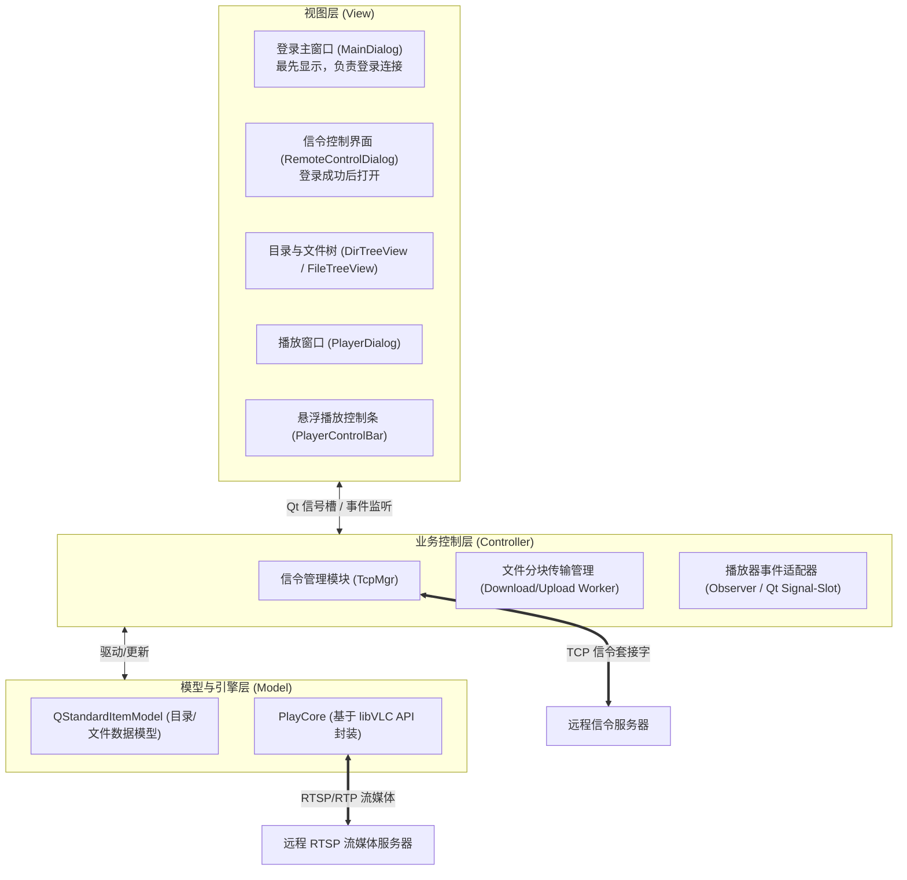
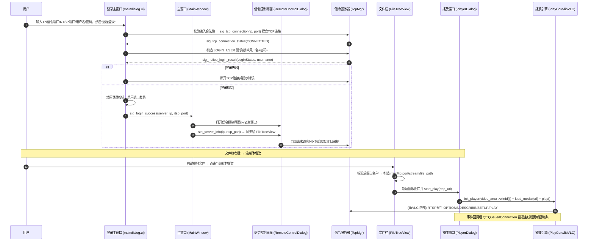
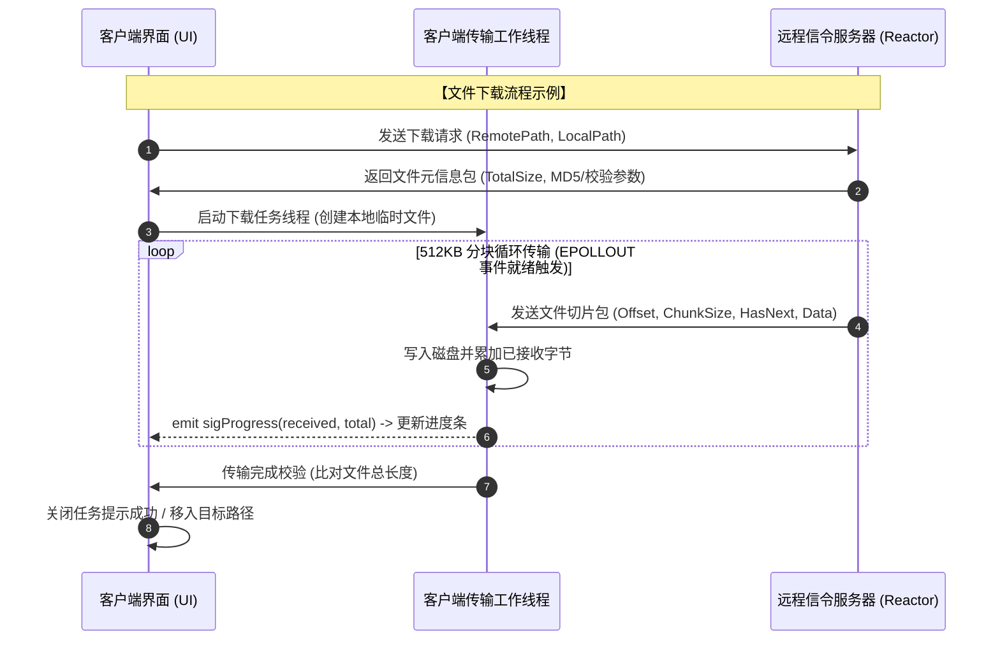
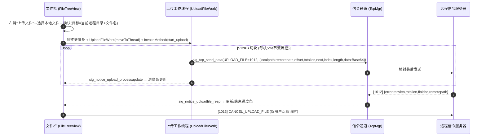
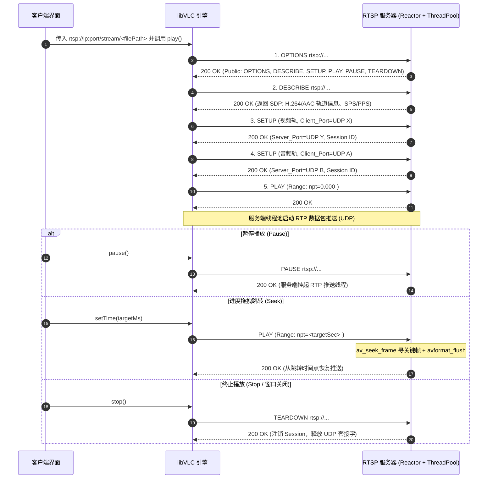
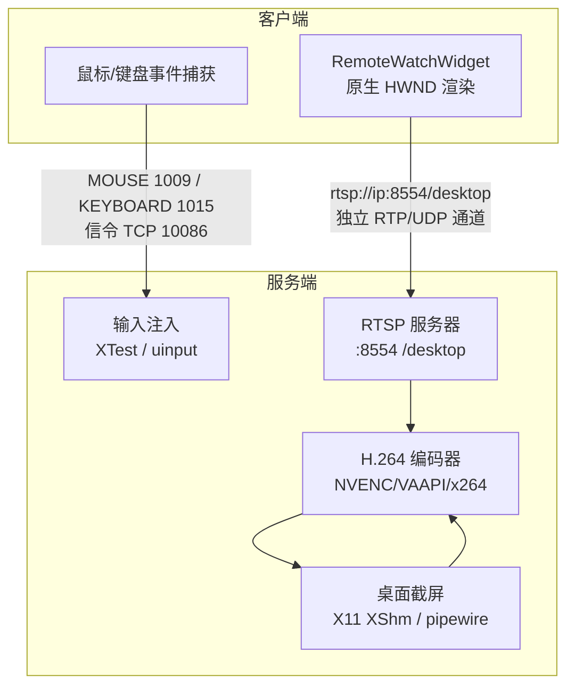

# NoDeskServerKit 客户端详细设计文档

---

## 1. 文档概述与背景

### 1.1 项目背景
在基于深度学习（如 YOLOv8）的目标检测等科研与工程场景中，模型训练服务器通常运行于无桌面环境（Headless Linux Server）。在此类环境中，开发人员排查模型训练与视频推理效果时面临以下痛点：
1. **多工具割裂**：依赖第三方 SSH/SFTP 工具上传测试集、下载标注结果视频，再通过本地独立播放器打开验证，多端切换流程繁琐。
2. **频次高、开销大**：模型调优验证涉及频繁的视频上传、推理结果下载与删除清理，大体积视频文件的全量往返下载严重拉低实验迭代效率。

### 1.2 系统定位
**NoDeskServerKit 客户端**是一套集**远程文件管控（目录浏览、文件上传/下载/删除/执行）**与**流媒体低延迟点播（RTSP/RTP）**于一体的轻量级 Windows 桌面端工具，旨在实现局域网内无桌面服务器音视频秒开预览与一站式文件管理。

---

## 2. 客户端总体架构设计

客户端遵循 **MVC（Model-View-Controller）** 架构设计思想，严格解耦 UI 视图表现、网络与控制逻辑及底层播放引擎。



### 2.2 界面流转与登录主窗口（本次核心改动）

客户端采用**登录主窗口最先显示**的界面流转设计，整体交互链路如下：



**主要修改点说明：**

| 修改文件 | 修改内容 |
| :--- | :--- |
| `maindialog.ui` | 改造为**登录主窗口**：新增远程主机 IP、登录端口、流媒体 RTSP 端口、用户名、密码输入框与"远程登录/退出登录"按钮 |
| `maindialog.h/.cpp` | 实现登录逻辑：输入校验 → 发起 TCP 连接 → 连接成功发送 `LOGIN_USER` 请求 → 接收登录结果 → 成功发出 `sig_login_success` |
| `mainwindow.h/.cpp` | 界面流转：启动显示登录主窗口；登录成功后打开信令控制界面并调用 `set_server_info(ip, rtsp_port)` |
| `global.h` | 新增 `LOGIN_USER=1000` 消息 ID、`LoginStatus` 登录结果枚举、`SERVER_RTSP_PORT`、可播放后缀白名单、`PlayerStatus` 枚举 |
| `tcpmgr.h/.cpp` | 新增 `sig_notice_login_result` 信号与 `LOGIN_USER` 响应回调（解析 error/username） |
| `remotecontroldialog.*` | 移除原登录输入区（迁至登录主窗口）；新增 `set_server_info()`，登录成功后自动请求磁盘分区初始化目录树；返回主界面时先断开连接 |
| `remotewatchwidget.*` | 监控窗口事件过滤器新增**键盘事件捕获**（按下/释放，含修饰键与输入字符）经 `KEYBOARD_REMOTE_CONTROL(1015)` 发送；窗口与显示控件设置 `StrongFocus` 焦点策略以接收键盘焦点；**方案 B**：内嵌 `PlayCore`，新增 `start_desktop_stream/stop_desktop_stream` 以 `rtsp://ip:port/desktop` 低延迟拉流渲染，`closeEvent` 自动停止 |
| `remotecontroldialog.h/.cpp` | `slot_open_remotewatch_widget` 升级为 `(RemoteWatchStatus, QString)`：成功时构造桌面 RTSP URL 并启动方案 B 拉流；`WATCH_NO_DESKTOP` 弹窗提示"服务器无桌面环境，远程监控不可用" |
| `tcpmgr.h/.cpp` | `sig_notice_joinremotewatch_result` 升级为 `(RemoteWatchStatus, QString)`，解析 `JOIN_TCP_REMOTEWATCH(1006)` 的 `error/msg` 并按状态码分发 |
| `remotewatchwork.h/.cpp` | `sig_open_remotewatch_widget` 升级为 `(RemoteWatchStatus, QString)`，仅 `WATCH_SUCCESS` 时开启监控工作状态 |
| `filetreeview.h/.cpp` | 右键菜单新增**文件上传**与**流媒体播放**入口：上传经 `UploadFileWork` 工作线程 512KB 切块发送 + 进度条；播放校验后缀白名单 → 构造 RTSP URL → 打开 `PlayerDialog` 播放 |
| `uploadfilework.h/.cpp` | 新增文件上传工作对象：子线程内按 512KB 切块构造 `UPLOAD_FILE(1012)` 请求，取消时发送 `CANCEL_UPLOAD_FILE(1013)`，进度/结果经信号槽跨线程回传 |
| `tcpmgr.h/.cpp` | 新增 `sig_notice_uploadfile_resp` 信号与 `UPLOAD_FILE(1012)` 响应回调（解析 error/recvlen/totallen/finishe/remotepath） |
| `playcore.h/.cpp` | 新增 libVLC 播放引擎封装（含 `NO_VLC` 空实现，无 SDK 时可编译但播放不可用） |
| `playerdialog.h/.cpp/.ui` | 新增播放窗口：视频渲染区 + 悬浮控制条（播放/暂停、进度条跳转、时长、音量/静音） |
| `RemoteControlClient.pro` | 纳入新增源文件；libVLC SDK 路径检测（未找到时定义 `NO_VLC` 宏降级编译） |

### 2.3 技术选型与权衡

| 评估维度 | libVLC（本方案选定） | 自研 FFmpeg 管道 | Qt 多媒体 (QtMultimedia) |
| :--- | :--- | :--- | :--- |
| **开发与交付周期** | **短（API 封装清晰）** | 极长（需手写解复用、同步、软硬解） | 极短 |
| **协议鲁棒性** | **极高（工业级 RTSP 容错与自适应）** | 取决于手写状态机质量，容错成本高 | 较弱（特定 RTSP/UDP 串流兼容差） |
| **功能扩展度** | 覆盖点播标准控制（Seek/Pause/Volume） | 适合底层像素级算法加工与定制渲染 | 深度定制参数支持弱 |
| **结论** | **最佳工程选型：低延迟稳定拉流 + 周期可控** | 适用于逐帧打框等特殊处理场景 | 不推荐在复杂网络串流场景中使用 |

---

## 3. UI 视图层设计 (View)

### 3.1 登录主窗口（MainDialog，最先显示）
程序启动后最先显示的窗口（`maindialog.ui`），负责完成远程登录连接：

- **远程登录区（`widget_7` 网格布局）**：
  - `ip_lineEdit`：远程主机 IP 地址。
  - `port_lineEdit`：信令登录端口（默认 `10086`）。
  - `rtsp_port_lineEdit`：流媒体 RTSP 端口（默认 `8554`，登录成功后用于构造拉流 URL）。
  - `ip_lineEdit_2`：用户名（Linux 系统账号）。
  - `ip_lineEdit_3`：密码（以密码模式回显，接入校验非空）。
- **操作按钮**：
  - `pushButton_remotecontrol`（远程登录）：校验全部输入合法后发起 TCP 连接，连接成功自动发送 `LOGIN_USER` 请求；登录成功后禁用本按钮、启用"退出登录"，并发出 `sig_login_success(ip, rtsp_port)` 打开信令控制界面。
  - `disconnect_pushButton`（退出登录）：二次确认后断开 TCP 连接，复位登录状态。
- **失败处理**：用户名不存在 / 密码错误 / 服务器内部错误时提示并自动断开连接，允许重新登录。

### 3.2 信令控制界面（RemoteControlDialog，登录成功后打开）
1. **目录浏览区（DirTreeView）**：
   - 继承自 `QTreeView`，绑定 `QStandardItemModel`。
   - 支持根目录一键获取、展开加载子目录结点（目录名、子目录数、权限、最后修改时间）。
   - **登录成功后自动请求一次磁盘分区信息初始化目录树**（由 `set_server_info()` 触发）。
2. **文件详情区（FileTreeView）**：
   - 继承自 `QTreeView`，展示指定目录下的所有文件项（文件名、文件大小、类型、权限、访问时间）。
   - **右键上下文菜单（ContextMenu）**：
     - 文件下载（触发本地保存路径选择器）
     - **文件上传**（触发本地文件选择器，选择后切块上传到当前文件所在远程目录，同名覆盖）
     - 远程执行（触发服务端可执行脚本/命令）
     - 文件删除（弹出二次确认提示框）
     - **流媒体播放**（过滤可播放音视频格式后缀：`.mp4`、`.mkv`、`.avi`、`.flv` 等，自动唤起播放窗口）
3. **远程锁机监控区**：
   - 远程监控、远程锁机、远程解锁按钮及监控窗口界面。
   - **在监控窗口中捕获鼠标事件**（按下/释放/移动/双击/滚轮）封装成信令消息发送给服务器进行执行。
   - **在监控窗口中捕获键盘事件**（按下/释放，含修饰键与输入字符）封装成信令消息发送给服务器进行执行。
   - **返回主界面**：返回前先断开 TCP 连接，回到登录主窗口。

### 3.2 视频播放与交互窗口
1. **视频呈现窗口（VideoWidget）**：
   - 基于 `QWidget` 实现，通过提取底层窗口句柄 `HWND`（`(void*)winId()`）并注入播放引擎，实现画面直出。
2. **悬浮播放控制条（PlayerControlBar）**：
   - 采用独立或透明浮动面板悬浮于视频窗口上方，通过鼠标移动事件（`mouseMoveEvent`）实现自动延时隐藏与唤醒。
   - **播放/暂停控件**：切换播放与暂停状态。
   - **自定义进度条（SeekSlider）**：继承 `QSlider`，重写 `mousePressEvent` 支持精准点击跳转（精确 Seek），并在拖拽时屏蔽时间戳自动回跳。
   - **播放时长标签**：格式化展示 `当前时间 / 总时长`（`hh:mm:ss`）。
   - **音量/静音控件**：集成静音切换按钮与水平音量滑块（0~100）。

---

## 4. 播放引擎层设计 (PlayCore)

### 4.1 核心职责与封装
基于 `libvlc` 原生 C API 进行封装，屏蔽底层句柄操作与结构体生命周期细节，对外提供标准面向对象接口：

```cpp
class PlayCore : public QObject {
    Q_OBJECT
public:
    explicit PlayCore(QObject* parent = nullptr);
    ~PlayCore();

    bool initPlayer(HWND renderHwnd);
    bool loadMedia(const QString& rtspUrl);
    
    void play();
    void pause();
    void stop();
    void setTime(int64_t timeMs);
    int64_t getTime() const;
    int64_t getLength() const;
    void setVolume(int volume);
    int getVolume() const;

signals:
    void sigTimeChanged(int64_t currentTimeMs);
    void sigLengthChanged(int64_t totalTimeMs);
    void sigStateChanged(int state);
    void sigBuffering(float cachePercent);
};
```

### 4.2 观察者模式与线程安全跨线程分发
libVLC 的底层事件回调（如 `libvlc_MediaPlayerTimeChanged`）触发于 **libVLC 内部工作线程**。为确保客户端 UI 线程安全，避免跨线程直接操作 UI 导致程序崩溃，架构采用**观察者模式 + Qt 队列化信号槽（`Qt::QueuedConnection`）**进行事件转换与分发：

```
+-----------------------------------------------------------+
|                   libVLC Worker Thread                    |
|  Event Callback: libvlc_MediaPlayerTimeChanged(newTime)   |
+-----------------------------+-----------------------------+
                              | (Post Event / C++ Callback)
                              v
+-----------------------------------------------------------+
|               PlayCore Event Adapter                      |
|       emit sigTimeChanged(currentTimeMs)                  |
+-----------------------------+-----------------------------+
                              | (Qt::QueuedConnection)
                              v
+-----------------------------------------------------------+
|                    Qt GUI Main Thread                     |
|  Slot: onTimeChanged() -> Update SeekSlider & TimeLabel    |
+-----------------------------------------------------------+
```

---

## 5. 信令与网络控制交互设计 (Controller)

### 5.1 登录与鉴权流程
1. 客户端发起与信令服务器的 TCP 连接。
2. 握手成功后，发送登录数据包（包含用户名与密码凭证）。
3. 接收登录响应包，根据错误码判断是否授权成功；若失败，断开 TCP 连接并友好提示用户。

### 5.2 目录浏览与文件树动态拉取
1. **家目录查询**：登录成功后，主动向服务器索取登录用户的家目录路径（`/home/<user>`）。
2. **按需节点展开**：当用户在 `DirTreeView` 单击/展开某一节点时，客户端发送获取该目录绝对路径内容的请求包。
3. **数据组装**：信令服务器逐项返回该路径下的文件及目录元数据，客户端依次写入 `QStandardItemModel`，同时清空并刷新当前选中的 `FileTreeView`。

### 5.3 大文件异步分块传输设计
为保障大文件传输过程中界面的高响应度与整体网络吞吐率，采用**512KB 定长分块 + 工作线程异步 I/O** 架构：





- **下载断流/取消控制**：若用户中途点击取消，客户端强制中止 `Worker` 线程，向服务端发出取消指令（服务端清空该文件写队列并注销 `EPOLLOUT` 监听），本地删除未完成的临时文件。
- **上传机制（已实现）**：`FileTreeView` 右键"上传文件"→选择本地文件→目标远程路径为**当前选中文件所在父目录 + 本地文件名**（同名覆盖）。`UploadFileWork` 在工作子线程内按 **512KB 切块**循环构造 `UPLOAD_FILE(1012)` 请求，经 `Qt::QueuedConnection` 排队交给 `TcpMgr` 发送（保证与其它信令有序），每块间 `5ms` 节流避免突发大流量冲垮网络；服务端按块回复 `error/recvlen/totallen/finishe/remotepath`，客户端据此更新进度条，`finishe=true` 且 `recvlen==totallen` 时判定成功。进度条"取消上传"触发 `CANCEL_UPLOAD_FILE(1013)` 中断循环并通知服务端丢弃后续块。

---

## 6. RTSP 流媒体交互与点播协议控制流程

客户端通过 libVLC 发起流媒体点播时，底层 RTSP 交互协议与服务器状态联动规范如下：



---

## 7. 关键技术难点与避坑策略

1. **DirectX 渲染覆盖导致浮动 UI 闪烁/遮挡**：
   - *问题*：Windows 下 libVLC 绑定 `HWND` 后直接通过 Direct3D 表面绘制，常规 Qt 子组件容易被覆盖或无法半透明呈现。
   - *方案*：浮动控制栏不作为视频控件的直系渲染子组件，而是采用 **`Qt::Tool | Qt::FramelessWindowHint` 无边框悬浮窗**，并重写父窗口的 `moveEvent` / `resizeEvent`，使其动态贴合跟随在播放区域下方。
2. **多线程并发冲突与 UI 卡顿**：
   - *问题*：文件分块传输（大吞吐）与信令接收共用套接字容易造成丢包或解析错乱；UI 线程若参与 I/O 会引起严重卡顿。
   - *方案*：信令通道与大文件传输通道做逻辑隔离，文件下载与上传务必置于专属 `QThread` 执行，进度反馈统一通过 Qt 信号槽跨线程投递。
3. **播放初始花屏与秒开优化**：
   - *问题*：点播初始阶段未接收到完整 SPS/PPS 导致前置帧解析失败，出现短时马赛克。
   - *方案*：在服务端 DESCRIBE 阶段将 SPS/PPS 以 Base64 编码方式填入 SDP `sprop-parameter-sets` 属性中；同时在客户端初始化 libVLC 时追加参数 `--network-caching=200`，在保证局域网流畅度的同时压低初始启动延迟。

---

## 8. 远程监控技术方案选型与实现（重要）

### 8.1 方案对比与选型结论

在方案评估阶段对比了三类实现路径，**最终选定方案 B（H.264 硬件编码 + RTSP/RTP/UDP）作为正式实现**：

| 方案 | 延迟表现 | 带宽占用 | 开发成本 | 结论 |
| :--- | :--- | :--- | :--- | :--- |
| 方案 A：MJPEG over TCP/UDP | 50~100ms | 中等（10~30Mbps） | 低 | 起步方案，带宽高、CPU 大，未采用 |
| **方案 B：H.264 编码 + RTSP/RTP/UDP** | **30~60ms** | **极低（1080p/30fps 仅 2~5Mbps）** | 中 | **✅ 正式选定**：复用已有 RTSP 服务器与 PlayCore 播放引擎 |
| 方案 C：引入 NoVNC / rust-desk / Parsec | 低 | 低 | 高 | 有跨公网与强加密需求时才考虑 |

**架构原则**：**视频流走独立 RTSP 通道（UDP），鼠标/键盘控制走信令 TCP 通道（10086）**，两条通道解耦，视频流不再挤占文件上传/下载的信令带宽，也消除了 TCP 队头阻塞（HOL Blocking）导致的控制指令延迟。



### 8.2 方案 B 客户端实现说明

| 文件 | 实现内容 |
| :--- | :--- |
| `global.h` | 新增 `RemoteWatchStatus` 枚举：`WATCH_SUCCESS=0` / `WATCH_NO_DESKTOP=1`（无桌面）/ `WATCH_ENCODER_ERROR=2`（编码器错误）/ `WATCH_SYSTEM_ERROR=3`（系统错误） |
| `tcpmgr.h/.cpp` | `sig_notice_joinremotewatch_result` 信号从 `bool` 升级为 `(RemoteWatchStatus status, QString msg)`，解析 `JOIN_TCP_REMOTEWATCH(1006)` 响应的 `error` 与 `msg` 字段并分发 |
| `remotewatchwork.h/.cpp` | `sig_open_remotewatch_widget` 同步升级为 `(RemoteWatchStatus, QString)`；仅在 `WATCH_SUCCESS` 时标记 `joinserver=true` 并开启工作 |
| `remotewatchwidget.h/.cpp` | **新增方案 B 渲染层**：内嵌 `PlayCore` 播放引擎，`start_desktop_stream(rtsp_url)` 将 `rtsp://ip:port/desktop` 绑定至 `showlabel` 原生 HWND 句柄实现低延迟直出渲染；`stop_desktop_stream()` 在 `closeEvent` 中自动调用释放资源；保留 `slot_show_screenpix()` 作为方案 A 兼容 |
| `remotecontroldialog.h/.cpp` | `slot_open_remotewatch_widget(RemoteWatchStatus, QString)`：成功时构造 `rtsp://<server_ip>:<rtsp_port>/desktop` 并调用 `watchwidget->start_desktop_stream()`；**`WATCH_NO_DESKTOP` 时弹窗提示"服务器处于无桌面环境（Headless），远程监控不可用，文件管理与点播功能仍可正常使用"**；编码器错误与系统错误分别给出具体提示 |

**无桌面自适应流程**（对齐需求）：服务端收到 `JOIN_TCP_REMOTEWATCH(1006)` 后探测 `$DISPLAY`/`XDG_SESSION_TYPE`，无桌面时返回 `{"error":1, "msg":"..."}`，客户端精准识别为 `WATCH_NO_DESKTOP` 并友好提示，不会打开空白监控窗口。

### 8.3 方案 B 服务端配合要求

服务端需实现（详见《NoDeskServerKit_服务端实现规范》3.7 节）：
1. 处理 `JOIN_TCP_REMOTEWATCH(1006)` 时探测桌面环境，按 `RemoteWatchStatus` 码返回。
2. 桌面存在时启动 `X11/XShm` 或 `pipewire` 截屏 → H.264 实时编码（NVENC/VAAPI 或 `x264 ultrafast`）→ 经已有 RTSP 服务器以 `/desktop` 路径对外提供 RTP 推流。
3. 鼠标（1009）与键盘（1015）指令经信令 TCP 通道注入，映射为 XTest/uinput 事件。
