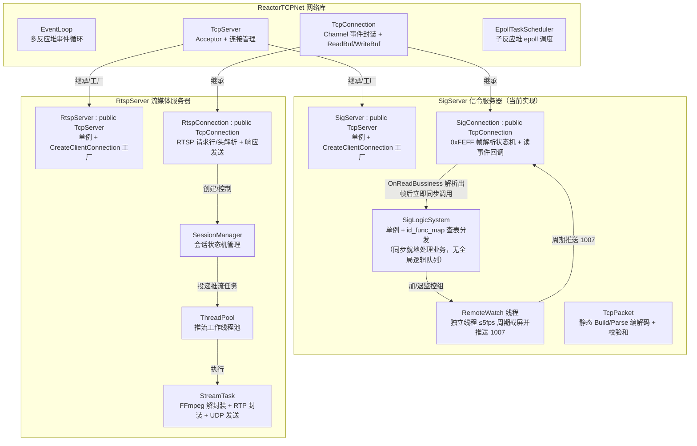

# NoDeskServerKit 服务器设计文档

> 本文档基于 `ReactorTCPNet` 主从 Reactor 网络库，详细描述 **信令服务器（SigServer）** 与 **RTSP 流媒体服务器（RtspServer）** 的类继承设计、包解析与业务处理逻辑。
> 信令服务器复用 `SigServers/LogicSystem.h` 的「消息 ID → 回调函数表（`id_func_map`）」分发模式；**在事件循环模型上按当前代码实现：在 Reactor 事件循环线程内解析出完整帧后立即同步分发处理（不采用生产者-消费者队列，降低延迟），而远程监控组保持独立工作线程周期推送（≤5fps）**；JSON 库全量采用 `jsoncpp`（`#include "jsoncpp/json/json.h"`）。

---

## 1. 总体架构

### 1.1 部署形态

| 服务 | 可执行程序 | 协议 | 默认端口 | 职责 |
| :--- | :--- | :--- | :--- | :--- |
| **SigServer** | `SigServer` | 自定义 TCP 二进制帧 + JSON 载荷 | `10086`（命令行可指定） | 登录鉴权、目录/文件管理、下载、远程监控组、鼠标注入、锁机 |
| **RtspServer** | `RtspServer` | RTSP over TCP（控制）+ RTP/RTCP over UDP（数据） | `8554` | 视频点播 OPTIONS/DESCRIBE/SETUP/PLAY/PAUSE/TEARDOWN，RTP 推送 H.264 + AAC |

两个服务按**分进程**部署，各自链接 `ReactorTCPNet` 静态库：

```cmake
add_subdirectory(ReactorTCPNet)   # 生成 ReactorTCPNet.a / TcpNet
add_subdirectory(SigServer)       # 链接 ReactorTCPNet + crypt + X11 + Xtst + jsoncpp + pthread
add_subdirectory(RtspServer)      # 链接 ReactorTCPNet + FFmpeg + pthread
```

### 1.2 模块划分



---

## 2. 复用基础：ReactorTCPNet 接口回顾

服务器层通过**继承** `TcpServer` / `TcpConnection` 并**重写虚函数**完成定制，无需修改网络库：

| 基类接口 | 作用 | 派生类定制点 |
| :--- | :--- | :--- |
| `TcpServer(int cpus, ip, port)` | 构造服务器，内部创建 `EventLoop`（默认 CPU 核数个 reactor） | 传入端口 `10086`/`8554` |
| `TcpServer::Start(ReactorModel)` | 启动事件循环（`MASTER_SLAVE` / `PEER_TO_PEER` / `SINGLE`） | main 中调用 |
| `TcpServer::CreateClientConnection(sockfd, actor)` | **工厂方法**，accept 后创建连接对象 | **重写**：返回 `SigConnection` / `RtspConnection` |
| `TcpConnection(sockfd, taskscheduler)` | 构造连接，绑定 Channel 到子 reactor | 派生类构造中设置业务回调 |
| `SetReadTcpCBDealCB(fn)` | 设置**读就绪业务回调** `void(ReadBuf&)` | 派生类实现帧/RTSP 解析 |
| `SetCloseTcpCBDealCB(fn)` | 设置**关闭业务回调** `void(TcpConnection)` | 派生类清理会话/推流资源 |
| `Send(total_len, data)` | 投递数据到 `WriteBuf` 队列，由 EPOLLOUT 驱动异步发送 | 业务层直接调用 |
| `_recvbuf` / `_sendbuf` / `_actor` | 读缓冲区 / 写缓冲区 / 所在反应堆 | 解析时操作 `_recvbuf`；注册定时任务用 `_actor` |
| `EventLoop::AddTimerTask(...)` | 在指定 reactor 添加定时器 | 远程监控周期截图、RTCP 周期发送 |
| `ReadBuf::ReadStartPos/ReadableDataSize/OffsetStartPos` | 粘包半包解析原语 | 见 §3.2 帧解析状态机 |

---

## 3. 信令服务器（SigServer）设计

### 3.1 类结构

```
SigServer : public TcpServer          // 单例，重写 CreateClientConnection
SigConnection : public TcpConnection  // 每客户端一个，帧解析 + 状态机 + 读写业务
SigLogicSystem                        // 单例，id_func_map 查表分发（同步处理）+ 独立监控推送线程
TcpPacket                             // 帧静态编解码（Build/Parse）与 16 位和校验
```

#### 3.1.1 `SigServer`

```cpp
class SigServer : public TcpServer {
private:
    static std::shared_ptr<SigServer> instance;
    SigServer(int cpus, std::string ip, uint16_t port);  // 默认 port=10086
public:
    static std::shared_ptr<SigServer> GetInstances(int cpus=0, std::string ip="0.0.0.0", uint16_t port=10086);
    // 工厂：accept 后创建 SigConnection
    std::shared_ptr<TcpConnection> CreateClientConnection(int sockfd,
        std::shared_ptr<EpollTaskScheduler> actor) override;
};
```

- `std::call_once` 保证单例线程安全。
- `main.cpp` 支持可选命令行端口（`./SigServer [port]`，缺省 10086）。
- `instance->Start(ReactorModel::MASTER_SLAVE)` 后，主线程进入持久休眠等待，保证各反应器线程长期驻留处理 I/O。

#### 3.1.2 `SigConnection`

```cpp
class SigConnection : public TcpConnection {
public:
    enum class ConnState : uint8_t { UNAUTH = 0, AUTHED, CLOSED };
private:
    std::atomic<ConnState> _state{ConnState::UNAUTH};
    std::string _username;          // 登录成功后绑定的系统用户名
    std::string _home_dir;          // /home/<username>，路径白名单根
    std::atomic<bool> _in_watch{false}; // 是否在远程监控组
    uint64_t _uid;                  // 唯一自增连接标识

    bool _closed = false;
    std::mutex _close_mutex;

    void OnReadBussiness(ReadBuf& buf);          // 读业务回调：解析帧并直接分发
    void OnCloseBussiness();                     // 关闭回调
    void SendFrame(DataId id, const char* body, uint32_t body_len);
public:
    SigConnection(int sockfd, std::shared_ptr<EpollTaskScheduler> actor);
    ~SigConnection();
    void Close();                                // 业务清理 + CloseTcpConnection

    void SendJson(DataId id, const std::string& json);
    void SendRaw(DataId id, const char* body, uint32_t body_len);

    ConnState GetState() const { return _state.load(); }
    void SetState(ConnState s) { _state.store(s); }
    const std::string& Username() const { return _username; }
    void SetUsername(const std::string& u) { _username = u; }
    const std::string& HomeDir()  const { return _home_dir; }
    void SetHomeDir(const std::string& d) { _home_dir = d; }

    bool InRemoteWatch() const { return _in_watch.load(); }
    void SetInRemoteWatch(bool v) { _in_watch.store(v); }

    uint64_t Uid() const { return _uid; }

    // 家目录白名单路径校验（规范 §3.6/§4.1）
    bool CheckPathInHome(const std::string& path) const;
    std::string SafeRealPath(const std::string& path) const;
};
```

构造函数直接在基类注册两个核心回调：

```cpp
SigConnection::SigConnection(int sockfd, std::shared_ptr<EpollTaskScheduler> actor)
    : TcpConnection(sockfd, actor) {
    SetReadTcpCBDealCB(std::bind(&SigConnection::OnReadBussiness, this, std::placeholders::_1));
    SetCloseTcpCBDealCB(std::bind(&SigConnection::OnCloseBussiness, this));
}
```

#### 3.1.3 帧解析与即时分发（`OnReadBussiness`）

在当前 Reactor 的读事件回调中，循环调用 `TcpPacket::Parse(buf, id, body, body_len)`。**解析出一个完整包后，不投递入队，直接同步调用 `SigLogicSystem::GetInstances()->HandlePacket(self, pkt)` 执行消息处理**：

```cpp
void SigConnection::OnReadBussiness(ReadBuf& buf)
{
    while (true) {
        DataId id = DataId::NO_MESSAGE;
        std::shared_ptr<char[]> body;
        uint32_t body_len = 0;

        TcpPacket::ParseResult r = TcpPacket::Parse(buf, id, body, body_len);
        if (r == TcpPacket::ParseResult::NEED_MORE)
            break;  // 数据未收齐，等待下次 EPOLLIN
        if (r == TcpPacket::ParseResult::BAD_FRAME)
            continue; // 校验失败已丢弃帧头，继续重扫

        auto pkt = std::make_shared<TcpPacket>(id, body, body_len);
        std::shared_ptr<SigConnection> self =
            std::static_pointer_cast<SigConnection>(shared_from_this());
        // 关键改动：直接在 Reactor 事件循环内同步分发处理
        SigLogicSystem::GetInstances()->HandlePacket(self, pkt);
    }
}
```

**帧布局与校验和（`TcpPacket` 严格实现）**：
- 帧结构：`0xFEFF(2)` + `DataLen(4,BE)` + `MsgId(2,BE)` + `Body(N)` + `Checksum(2,BE)`
- `DataLen = 2(MsgId) + N(Body) + 2(Checksum)`，位于帧偏移 `2..5`
- 校验和：`0xFE + 0xFF + DataLen(4字节) + MsgId(2字节) + Body(N字节)` 累加，低 16 位溢出回绕写入帧尾

#### 3.1.4 `SigLogicSystem` —— 查表同步分发 + 监控组工作线程

取消了全局业务逻辑的消费者线程池和待处理队列，仅保留 `id_func_map` 快速查表调用；远程监控截图推送保留独立工作线程（`send_remotewatch_thread_work`）：

```cpp
class SigLogicSystem {
private:
    std::atomic<bool> server_running{true};

    // 消息ID → 处理函数映射表（参考 LogicSystem 设计）
    std::map<DataId, std::function<void(std::shared_ptr<char[]>, std::shared_ptr<SigConnection>)>> id_func_map;

    // 远程监控组（独立工作线程，周期推送）
    std::queue<std::shared_ptr<SigConnection>> remotewatch_queue;
    std::unordered_set<uint64_t> remotewatch_set;
    std::mutex watch_queue_mutex, watch_set_mutex;
    std::condition_variable watch_cond_consume;
    std::vector<std::thread> send_remotewatch_threads;

    // X11 Display（用于鼠标事件注入与截图）
    Display* display = nullptr;
    std::mutex display_mutex;

    static std::shared_ptr<SigLogicSystem> instance;
    SigLogicSystem();
    void init_id_function();
    void send_remotewatch_thread_work();

    void add_remotewatch_client(std::shared_ptr<SigConnection>);
    void delete_remotewatch_client(std::shared_ptr<SigConnection>);
public:
    ~SigLogicSystem();
    static std::shared_ptr<SigLogicSystem> GetInstances();

    // 由 Reactor 线程在 OnReadBussiness 中直接同步调用
    void HandlePacket(std::shared_ptr<SigConnection> conn, std::shared_ptr<TcpPacket> packet);

    // 连接关闭时触发：从监控组移出、清理资源
    void remove_client(std::shared_ptr<SigConnection> conn);
    void Stop();
};
```

**发送路径**：业务处理器调用 `conn->SendJson(id, json_str)`，内部调用 `TcpPacket::Build` 成帧后调用 `TcpConnection::Send(total, frame)`，数据立即入 `WriteBuf` 发送并在未发完时注册 `EPOLLOUT` 驱动。

### 3.2 消息处理器注册表（`init_id_function`）

全量采用 `jsoncpp` 库（`#include "jsoncpp/json/json.h"`）的 `CharReaderBuilder` 解析与 `StreamWriterBuilder` 紧凑输出。

```cpp
static std::string ToJsonStr(const Json::Value& v) {
    Json::StreamWriterBuilder wb;
    wb["indentation"] = ""; // 紧凑输出，与 Qt QJsonDocument::toJson() 格式对齐
    return Json::writeString(wb, v);
}
```

| DataId | 处理器 | 请求字段 → 响应字段 | 处理逻辑要点 |
| :--- | :--- | :--- | :--- |
| `1000 LOGIN_USER` | `HandleLogin` | `{username,password}` → `{error,username}` | `getspnam()`+`crypt()` 或 PAM 校验系统账号；成功置 `AUTHED`、记录 `_username`/`_home_dir=/home/<u>`；error∈{0,1,2,3}；**失败立即 `conn->Close()`** |
| `1001 GET_DRIVERINFO` | `HandleGetDriver` | `{data:"empty"}` → `{error,system:"Linux",driverinfo:"/home/<u>"}` | 校验已登录；`driverinfo` 返回绑定家目录（逗号分隔列表） |
| `1002 GET_DIRINFO` | `HandleGetDir` | `{path}` → 逐条 `{error,next,parent_path,name,type,size,permissions,access_time,symlink_target}` + 末帧 `next:false` | `opendir`/`readdir`+`lstat`；先目录后文件；路径需 `CheckPathInHome`；**空目录也发结束帧** |
| `1003 DOWNLOAD_FILE` | `HandleDownload` | `{sourcesavepath,destfilepath}` → head帧`{error,head:true,totallen,index:0,next}` → 512KB 块`{head:false,length,index,data:Base64,next}` | 校验路径在 home 内；发头帧后**延迟 ~200ms 再推首块**（客户端建进度条需时）；分块走 EPOLLOUT：`PumpDownload()` 每写就绪发 1 块（`ReadBuf` 方向无关，直接 `Send()` 入队由反应堆驱动），最后 `next:false` 收尾 |
| `1004 EXECUTE_FILE` | `HandleExecute` | `{executefilepath}` → `{error,executefilepath}` | 白名单校验 → `fork`+`execl`(或 `system()`，注意返回值映射 error) |
| `1005 DELETE_FILE` | `HandleDelete` | `{deletefilepath}` → `{error,deletefilepath}` | 白名单校验 → `unlink()`/`rmdir()`；**必须防 `../` 穿越**（`realpath` 后比较 home 前缀） |
| `1006 JOIN_TCP_REMOTEWATCH` | `HandleJoinWatch` | `{data:"empty"}` → `{error,msg}` | **探测桌面环境**：无桌面返回 `error:1 (WATCH_NO_DESKTOP), msg:"服务器处于无桌面环境..."`；有桌面返回 `error:0` 并将连接加入监控组，客户端据此启动 `rtsp://ip:8554/desktop` 方案 B 拉流 |
| `1008 EXIT_TCP_REMOTEWATCH` | `HandleExitWatch` | `{data:"empty"}` → `{error:0,msg:""}` | 移出监控组，客户端停止推拉流 |
| `1009 MOUSE_REMOTE_CONTROL` | `HandleMouse` | `{xScale,yScale,button,type}` → 无响应 | `display_mutex` 保护下 `XTestFakeMotionEvent`/`XTestFakeButtonEvent`；type∈{pressed,released,moved,dblclick,wheel}；按键映射 Qt→X11（1→1,2→3,4→2；滚轮 4/5/6/7 原样）；坐标 `x=xScale*WidthOfScreen` |
| `1010 LOCK_REMOTE_CONTROL` | `HandleLock` | `{data:"empty"}` → 无 | `system("loginctl lock-session")` 或桌面锁命令 |
| `1011 UNLOCK_REMOTE_CONTROL` | `HandleUnlock` | `{data:"empty"}` → 无 | `system("loginctl unlock-session")` |
| `1012 UPLOAD_FILE` | `HandleUpload` | `{localpath,remotepath,offset,totallen,next,index,length,data:Base64}` → 每块回响应 `{error,recvlen,totallen,finishe,remotepath}` | 家目录白名单校验；按 `offset` 写入落盘并 flush；`next:false` 收尾校验 `recvlen==totallen`（不一致返回 error=3 并清理） |
| `1013 CANCEL_UPLOAD_FILE` | `HandleCancelUpload` | `{localpath,remotepath}` → 无/可选确认 | 标记取消该文件上传，删除半成品临时文件，后续到来的同名块直接丢弃 |
| `1015 KEYBOARD_REMOTE_CONTROL` | `HandleKeyboard` | `{keycode,modifiers,text,type}` → 无响应 | 远程键盘按键注入：将 Qt keycode 转换为 X11 Keysym 再通过 `XKeysymToKeycode` 换算为 KeyCode，调用 `XTestFakeKeyEvent` 模拟按下或释放 |
| `1100 SEND_MSG` / `1101 SEND_FILE` | `HandleSendMsg/File` | （预留聊天）广播 | 遍历在线 conn 广播 JSON |

**`1007 GET_REMOTEWATCH_SCREEN`（方案 A 兼容预留）**：
- 方案 A（兼容模式）：监控线程从 `remotewatch_queue` 轮转推送 Base64 JPEG/PNG 截图。
- **方案 B（正式默认方案）**：视频画面完全走 **RTSP 8554 独立推流通道（`/desktop` 路由）**，通过硬件/libx264 零延迟编码器进行 RTP/UDP 推流，信令 TCP 通道仅承载鼠标（1009）和键盘（1015）控制事件，彻底解耦音视频数据与控制信令。

**路径安全（贯穿 1002/1003/1004/1005）**：
```cpp
bool SigConnection::CheckPathInHome(const std::string& p) const {
    char real[PATH_MAX];
    if (!realpath(p.c_str(), real)) return false;
    return std::string(real).find(_home_dir + "/") == 0 || std::string(real) == _home_dir;
}
```

**下载流控注意点**：`Send()` 入队后由反应堆 EPOLLOUT 异步发送，处理器线程无需自己注册写事件；但**每块单独一帧入队即可**，`WriteBuf` 队列顺序保证块序。首块延迟可借 `EventLoop::AddTimerTask` 或直接处理器 `usleep(200ms)`（逻辑线程内休眠无妨）。若需取消支持，约定 `1013 CANCEL_DOWNLOAD` → 置 `_dl_task.reset()` 并停止入队。

### 3.3 依赖库

- JSON：`jsoncpp`（或 `nlohmann/json`，替代 Qt `QJsonDocument`）
- 鉴权：`libpam` 或 `libcrypt`（`getspnam`+`crypt`）
- 截屏/鼠标：`libX11`, `libXtst`
- Base64：自实现（或 `libcrypto`）

---

## 4. RTSP 流媒体服务器（RtspServer）设计

### 4.1 类结构

```
RtspServer : public TcpServer           // 单例，端口 8554，重写 CreateClientConnection
RtspConnection : public TcpConnection   // 每客户端 RTSP 控制通道
RtspSessionManager                      // 会话表：SessionId → RtspSession
RtspSession                             // INIT→SETUP→PLAYING⇄PAUSED→TEARDOWN
StreamTask                              // FFmpeg 解封装 + RTP 封装 + UDP 发送（线程池执行）
RtpPacket / RtpSender                   // RFC3984(H264) / RFC3640(AAC) 封装
ThreadPool                              // 推流工作线程池
```

#### 4.1.1 `RtspServer`

与 `SigServer` 完全同构：

```cpp
class RtspServer : public TcpServer {
    static std::shared_ptr<RtspServer> instance;
    RtspServer(int cpus, std::string ip, uint16_t port);   // 默认 8554
public:
    static std::shared_ptr<RtspServer> GetInstances(int cpus=0, std::string ip="0.0.0.0", uint16_t port=8554);
    std::shared_ptr<TcpConnection> CreateClientConnection(int sockfd,
        std::shared_ptr<EpollTaskScheduler> actor) override;   // → RtspConnection
};
```

`main.cpp`：`RtspServer::GetInstances(0,"0.0.0.0",8554)->Start(MASTER_SLAVE)`；同时创建 `ThreadPool`（如 `std::thread::hardware_concurrency()` 个推流线程）。

#### 4.1.2 `RtspConnection`

```cpp
class RtspConnection : public TcpConnection {
private:
    std::shared_ptr<RtspSession> _session;   // 当前连接绑定的会话（SETUP 后建立）
    void OnReadBussiness(ReadBuf& buf);      // RTSP 文本请求解析
    void OnCloseBussiness();
    // —— RTSP 解析 ——
    bool ParseRequest(ReadBuf& buf, RtspRequest& req);
    void HandleRequest(const RtspRequest& req);
    void SendResponse(int code, const std::string& status_msg, int cseq, const std::string& hdrs, const std::string& body="");
public:
    RtspConnection(int sockfd, std::shared_ptr<EpollTaskScheduler> actor);
    void Close();
};
```

**解析要点与路由分发**：
- 在 `_recvbuf` 中扫描 `"\r\n\r\n"` 作为**请求边界**；不足则等待。
- **双路由支持**：
  1. **实时桌面流路由 (`/desktop`)**：用于远程监控方案 B（`rtsp://<ip>:<port>/desktop`）。调用 `RtspSessionManager::CreateDesktopSession`，启动 `DesktopStreamTask` 进行 X11 屏幕抓取并通过 `libx264` 实时编码（`zerolatency` + `ultrafast`）向客户端推送 RTP/UDP 包。
  2. **视频点播路由 (`/stream/<filePath>`)**：从 `/stream` 后截取文件路径，兼容前导双斜杠与 URL Decode，做家目录白名单校验，启动 `StreamTask` 点播 MP4 文件。

#### 4.1.3 `RtspSession` 状态机

```cpp
enum class SessState { INIT, DESCRIBED, SETUP, PLAYING, PAUSED, TORN_DOWN };

struct RtspSession {
    std::string session_id;          // 16 位随机 hex
    SessState state = INIT;
    std::string file_path;           // 媒体文件绝对路径
    int cseq = 0;
    // 每条轨道（0=video H264, 1=audio AAC）
    struct Track {
        int track_id;
        int client_rtp_port, client_rtcp_port;
        int server_rtp_sock, server_rtcp_sock;  // UDP 套接字
        sockaddr_in client_addr;
        bool setup = false;
    } tracks[2];
    int track_count = 0;
    std::weak_ptr<RtspConnection> conn;
    std::shared_ptr<StreamTask> stream_task;   // 推流任务
    double duration_sec = 0;
    double seek_base = 0;            // Range 请求定位点
};
```

`RtspSessionManager`（单例）：`unordered_map<string, shared_ptr<RtspSession>>` + mutex；`CreateSession()/Find(id)/Remove(id)`。

**方法分派（`HandleRequest`）**：

| 方法 | 状态要求 | 响应与动作 |
| :--- | :--- | :--- |
| `OPTIONS` | 任意 | `200` + `Public: OPTIONS, DESCRIBE, SETUP, PLAY, PAUSE, TEARDOWN` |
| `DESCRIBE` | INIT | 打开文件（`avformat_open_input`）探测流 → 生成 **SDP**（见 §4.2）→ `200`+`Content-Type: application/sdp`+`Content-Length`；状态→DESCRIBED，创建 session |
| `SETUP` | DESCRIBED/SETUP | URL 尾段 `trackID=0/1` 选定轨道；解析 `Transport: RTP/AVP;unicast;client_port=rtp-rtcp`；为服务端创建 RTP/RTCP **UDP socket 绑定随机端口对**；响应 `Transport: RTP/AVP;unicast;client_port=x-y;server_port=a-b` + `Session: <id>`；状态→SETUP |
| `PLAY` | SETUP/PAUSED | 解析 `Range: npt=x-`（缺省=0）；`StreamTask` 投递线程池（`seek_base=x` 时 `av_seek_frame` 到前关键帧 + `avformat_flush`）；响应 `200`+`Session`+`Range: npt=<实际>-`；状态→PLAYING |
| `PAUSE` | PLAYING | `stream_task->pause()`（保留 socket/会话）；`200`；状态→PAUSED |
| `TEARDOWN` | 任意非 TORN | `stream_task->stop()`，关 UDP、释放 fmt_ctx、SessionManager 移除；`200`；状态→TORN_DOWN |
| 非法状态 | — | `455 Method Not Valid In This State` |
| 其他 | — | `501 Not Implemented` |

**连接断开清理**（`OnCloseBussiness`）：若 `_session` 存在 → 等效 TEARDOWN 回收（防止 UDP/socket 泄漏）。

#### 4.1.4 SDP 生成（DESCRIBE 响应体）

`avformat_find_stream_info` 后按流生成：

```
v=0
o=- 0 0 IN IP4 0.0.0.0
s=NoDeskServerKit
t=0 0
a=control:*
m=video 0 RTP/AVP 96
a=rtpmap:96 H264/90000
a=fmtp:96 profile-level-id=42C01F;packetization-mode=1;sprop-parameter-sets=<B64(SPS)>,<B64(PPS)>
a=control:trackID=0
m=audio 0 RTP/AVP 97
a=rtpmap:97 mpeg4-generic/48000/2
a=fmtp:97 streamType=5;profile-level-id=1;mode=AAC-hbr;config=1210;SizeLength=13;IndexLength=3;IndexDeltaLength=3
a=control:trackID=1
```

- SPS/PPS：从视频流 `codecpar->extradata`（AVCDecoderConfigurationRecord）解析 nalLengthSize 与 SPS/PPS 序列 → 各自 Base64。
- AAC `config`：音频流 `extradata` 前 2 字节 AudioSpecificConfig 转 hex（48kHz/LC→`1210`）。
- 无音频流 → 省略 `m=audio`；仅视频文件常见。

#### 4.1.5 `StreamTask` —— 推流工作单元（线程池执行）

```cpp
class StreamTask {
    std::weak_ptr<RtspSession> _sess;
    AVFormatContext* _fmt = nullptr;
    int _vsi = -1, _asi = -1;              // 视频/音频流索引
    std::atomic<bool> _running{true}, _paused{false};
    uint16_t _vseq = 0, _aseq = 0;         // RTP 序号
    uint32_t _vts = 0, _ats = 0;           // RTP 时间戳
    uint32_t _ssrc;
    int _nal_len_size = 4;                 // AVCC 长度前缀字节数
    // 时钟基准（防漂移）
    std::chrono::steady_clock::time_point _t0;
    int64_t _pts0_v = 0, _pts0_a = 0;
public:
    void run();       // 线程池入口
    void pause()  { _paused = true; }
    void resume() { _paused = false; }
    void stop()   { _running = false; }
    void seek(double sec);   // PLAY(Range) 时调用
};
```

**`run()` 主循环**：

```
avformat_open_input(file) → find streams → extradata 提取(SPS/PPS/ASC/nal_len_size)
若 seek_base>0: av_seek_frame(-1, seek_ts, BACKWARD) + avformat_flush
首发: SPS、PPS 各打一单 RTP 包(track0)；t0=now, 记录首个pts基准
while _running && av_read_frame(pkt)==0:
    if _paused: sleep(10ms); continue;               // PAUSE 挂起
    if pkt.video:
        pts_ms = (pkt.pts - pts0_v)*timebase*1000
        sleep_until(t0 + pts_ms)                      // 绝对时钟节奏
        按 AVCC 循环切 NALU:
            nalu ≤1300 → 单包 RTP(PT=96, seq++, ts=90k时间戳, M=帧末)
            nalu >1300 → FU-A 分片(≤1300/片, indicator=(h&0xE0)|28,
                         header=(h&0x1F)|S/E位) 共帧时间戳
        sendto(client_addr, server_rtp_sock)
        vts += 90000/fps                              // 或按 pts 差值
    if pkt.audio:
        pts_ms 同上；sleep_until
        载荷 = AU-headers-length(2B,=16) + AU-header(2B: 13bit size|3bit 0) + AAC裸数据
        RTP(PT=97, seq++, ts=ats)；ats += 1024        // 48kHz
        sendto(audio udp sock)
av_packet_unref; 清理资源 → TORN_DOWN
```

- **时钟驱动**：`sleep_until(t0 + 帧pts偏移)`，丢帧时按 pts 追赶，避免累积漂移与音画不同步。
- **Seek**：`seek(sec)` 由 PLAY(Range) 触发：`av_seek_frame(_fmt, -1, sec*AV_TIME_BASE, BACKWARD)` → `avformat_flush` → 重置 `t0/pts0` → 回到循环。
- **线程安全**：`pause/stop/seek` 仅改原子标志；socket 生命周期由 Session 持有，`sendto` 用 track 内已存地址。
- 线程池：固定 `N` 个工作线程 + 任务队列（可复用 `SigLogicSystem` 的队列模式），`PLAY` 时 `pool.post(stream_task)`；`PAUSE/TEARDOWN` 通过标志控制，不取消线程。

#### 4.1.6 RTP 封装细节（`RtpSender`）

```cpp
// 公共头 12B: V=2|seq|timestamp|ssrc|PT
send_rtp(sock, addr, pt, seq, ts, marker, payload, len);
// H264
send_nalu_single(...);   // ≤1300B
send_nalu_fua(...);      // >1300B, max_payload=1300
// AAC (RFC3640 hbr)
send_aac(...);           // AU-headers-length=16 + AU-header + raw
```

常量：`RTP_PT_VIDEO=96`，`RTP_PT_AUDIO=97`，`MAX_RTP_PAYLOAD=1300`，视频时钟 `90000`，音频时钟=采样率(48000)，AAC 增量 `1024`。

### 4.2 依赖库

- FFmpeg：`libavformat`, `libavcodec`, `libavutil`（解封装 + extradata 解析 + seek）
- 无额外网络依赖（UDP `sendto` 直接用 POSIX socket）

---

## 5. 两服务器对比与复用关系

| 维度 | SigServer（信令） | RtspServer（流媒体） |
| :--- | :--- | :--- |
| 传输 | 单 TCP 长连接（信令+下载+监控截图复用） | TCP（RTSP 控制）+ UDP（RTP/RTCP 数据） |
| 协议解析 | 二进制帧状态机（0xFEFF 扫描 + checksum） | 文本协议（`\r\n\r\n` 边界 + 头字段解析） |
| 连接类 | `SigConnection : TcpConnection` | `RtspConnection : TcpConnection` |
| 服务类 | `SigServer : TcpServer`（单例，工厂） | `RtspServer : TcpServer`（单例，工厂） |
| 业务分发 | **在当前 Reactor 读事件内直接同步查表处理**（低延迟），远程监控组保留独立推送线程（≤5fps） | `ThreadPool` + `StreamTask`（会话→任务） |
| 状态机 | `UNAUTH→AUTHED→CLOSED` + 监控组标志 | `INIT→DESCRIBED→SETUP→PLAYING⇄PAUSED→TORN` |
| 大数据发送 | WriteBuf 队列 + EPOLLOUT 分块下载（512KB） | UDP `sendto` 每帧推流（独立 socket） |
| 周期任务 | 监控截图独立线程轮转推送（≤5fps，缩略降采样） | RTP 时钟驱动休眠（run 循环内） |
| 清理 | `Close()` 清登录态/监控组/下载任务 | `Close()` 等效 TEARDOWN 释放会话/UDP |

**共同模式**：均在派生 `TcpConnection` 构造中 `SetReadTcpCBDealCB`/`SetCloseTcpCBDealCB` 注册业务回调；解析完整数据单元后驱动后续业务处理；发送统一走 `Send()` → `WriteBuf` → EPOLLOUT 异步写驱动。

---

## 6. 实现检查清单

### SigServer
- [x] `SigServer`/`SigConnection` 继承体系与工厂重写
- [x] 0xFEFF 帧状态机 + 校验和（含前缀项，uint16 溢出回绕）
- [x] `SigLogicSystem`：Map 注册全部 DataId 处理器（已全面接入 `jsoncpp`）
- [x] **无全局任务队列**：在 Reactor 事件循环线程中直接就地同步分发执行
- [x] 远程监控桌面探测：`JOIN_TCP_REMOTEWATCH(1006)` 自动检测 `$DISPLAY` 与 X11 环境，无桌面返回 `error:1`，有桌面返回 `error:0`
- [x] 登录鉴权：root 走 `shadow+crypt`，开发环境支持测试凭证；鉴权失败立即断连
- [x] `GET_DIRINFO`：逐条推送 + `next:false` 结束帧
- [x] `DOWNLOAD_FILE`：文件头帧先行 + 512KB 分块 + `next:false` 收尾
- [x] `UPLOAD_FILE(1012)`：512KB 分块接收与 Base64 解码，按 `offset` 写入落盘，每块回传进度与 `finishe` 结果
- [x] `CANCEL_UPLOAD_FILE(1013)`：取消上传标记，丢弃后续块并清理半成品文件
- [x] 路径白名单防护（限制在登录用户家目录内，防 `../` 穿越）
- [x] `MOUSE_REMOTE_CONTROL(1009)`：XTest 鼠标事件模拟注入（pressed/released/moved/dblclick/wheel）
- [x] `KEYBOARD_REMOTE_CONTROL(1015)`：Qt keycode 映射至 Linux X11 Keysym 并通过 XTest 注入按键按下/释放事件
- [x] 锁机与解锁系统命令触发
- [x] 协议客户端测试覆盖（`SigClientTest` 26 项全部 PASS）

### RtspServer
- [x] `RtspServer`/`RtspConnection` 继承体系与工厂重写（继承 `TcpServer` 与 `TcpConnection`）
- [x] RTSP 文本解析（支持 OPTIONS, DESCRIBE, SETUP, PLAY, PAUSE, TEARDOWN，含 CSeq 回显、URL Decode、双斜杠路径容忍）
- [x] 完整会话状态机管理（`RtspSession` 与 `RtspSessionManager`）
- [x] **双路由设计**：标准视频点播（`/stream/<path>`）与实时桌面推流方案 B（`/desktop`）
- [x] `DesktopStreamTask`：X11 屏幕图像采集，YUV420P 像素转换，`libx264` 极速零延迟编码（`ultrafast` + `zerolatency`），RTP/UDP 推流
- [x] SDP 描述生成（从 MP4 提取 H.264 SPS/PPS 并 Base64 编码内联至 `sprop-parameter-sets`，AAC 提取 `config`）
- [x] SETUP 逐轨 UDP 端口对分配与回显（`server_port=x-y` 与 `Session`）
- [x] `StreamTask`：FFmpeg 解封装，AVCC 长度前缀切分 NALU，≤1300 单包封装，>1300 FU-A 分片封装
- [x] 音视频同步与速率控制：基于高精度单调时钟 `sleep_until` 驱动，防止累积漂移
- [x] PLAY Range 跳转定位支持（`av_seek_frame` + `avformat_flush`）
- [x] PAUSE 挂起与保留通道；TEARDOWN 完整回收线程、FFmpeg 上下文与 UDP 通道
- [x] 全链路客户端协议测试覆盖（`RtspClientTest` 15 项全链路测试全部 PASS）

---

> **版本**：v1.0 · 基座 `ReactorTCPNet`（主从 Reactor + epoll + ReadBuf/WriteBuf + 定时任务）
> 协议细节以 `NoDeskServerKit_服务端实现规范.md` 为准；信令业务函数风格对齐 `SigServers/LogicSystem.cpp`。
